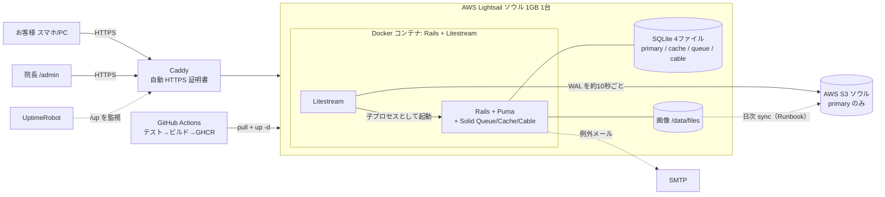
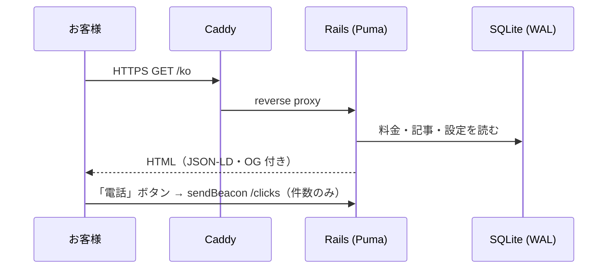
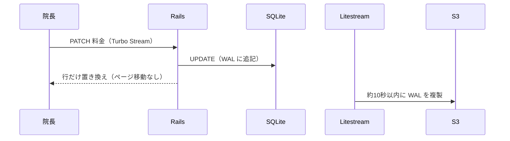
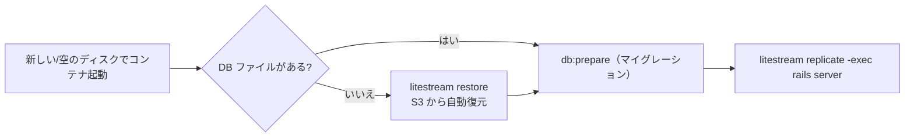
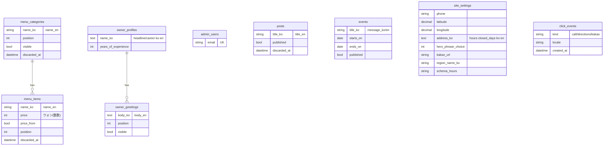

# 恩波（ウンパ）美容室ホームページ

[한국어 README → README.md](README.md)

**町の美容室（院長の経歴30年）のホームページ。40〜70代のお客様が迷わず使え、コードを書けない院長が自分で更新できる。「小さく・安く・壊れにくい」を設計の軸にしました。**

| モバイル | PC |
|---|---|
|  |  |

🔗 デモ: 未公開（本番サーバー未作成。ローカル／一時リンクで動作確認済み）

> **このリポジトリの読み方（面接官の方へ）**: ①§0 サマリー（30秒）→ ②§1 要件定義（ヒアリングの観点と設計への反映）→ ③§2 アーキテクチャ → ④§3 トレードオフとリスク → ⑤§4 検証結果と**未検証の項目** → ⑥§5 想定質問。判断の根拠はすべて [docs/adr/](docs/adr/) にあります。

## 0. 30秒サマリー

| 項目 | 内容 |
|---|---|
| 何を | 町の美容室の公式サイト（4ページ: ホーム・紹介・ブログ・アクセス）+ 院長用の管理画面 |
| 誰のため | お客様（40〜70代、スマホ中心）／院長（非エンジニア）／運用する開発者（1人） |
| 規模 | 町の1店舗。読み取り中心、書き込みは管理者1人。同時アクセスは少数 |
| 技術 | Rails 8.1 + Hotwire / SQLite（WAL）+ Solid Queue・Cache・Cable / Litestream → S3 / Docker 1台構成（+ Caddy） |
| コスト目標 | **月 約 $5**（AWS Lightsail ソウル 1GB。料金は契約前に再確認） |
| 設計の軸 | ① 目的に対して過剰な技術を入れない ② 非エンジニアが壊せない・戻せる ③ 判断の理由と代替案を ADR に残す |
| 実測 | メモリ 約 266MiB（上限 700MB 内）／ Lighthouse モバイル 87〜94（Accessibility 100, SEO 100）／ テスト 93 件成功 |
| 正直な未達 | 本番サーバーへの配備・S3 での復元テストは**未実施**（§4 参照） |

## 1. 要件定義（ヒアリング）

### 1-1. ステークホルダーと課題

| 立場 | 困りごと・期待 | 設計での答え |
|---|---|---|
| お客様（40〜70代） | 料金・場所・営業時間をスマホで確認したい。小さい文字や複雑な操作は苦手 | 本文18px以上・ボタン48px以上・コントラスト AA、下部固定メニュー、「電話／道案内」の大きなボタン |
| 院長（非エンジニア） | 料金・休業・写真を自分で直したい。壊したり消したりが怖い | 韓国語の管理画面、料金の**その場編集**、**ゴミ箱で復元**、確認ダイアログ |
| 開発者（運用担当 1人） | 手間と費用をかけず、止まらず、壊れても戻したい | 単一サーバー + 連続バックアップ + Runbook、自動デプロイ |
| 検索エンジン／地図 | 「근처 미용실」「은파미용실」で見つけてもらいたい | NAVER プレイスが主、サイトは JSON-LD・sitemap・タイトルに地域名で補強 |

### 1-2. ヒアリング項目 → 回答・前提 → 設計への反映

「確度」: ◎＝依頼者が明示した要件／○＝事業の性質からの前提（本番前に再確認）／△＝想定（未確認）。

| # | 質問（ヒアリング観点） | 回答・前提 | 確度 | 設計への反映（根拠） |
|---|---|---|---|---|
| 1 | 誰が見るか？ | 40〜70代の女性、スマホ中心 | ◎ | 大きな文字・ボタン、自動スライド禁止、下部固定バー（CLAUDE.md、CSS の `:root` 変数） |
| 2 | 誰が更新するか？ | コードを書けない院長 | ◎ | 韓国語UI・大きなボタン・その場編集（ADR 0010） |
| 3 | 何を一番伝えたいか？ | 30年の経験、料金公開、電話・道案内 | ◎ | ホームの文言候補3つ（管理画面で選択/自由入力）、料金表、電話/道案内ボタン |
| 4 | 予算は？ | 月 数ドル（無料枠を活用） | ◎ | 1GB の小型サーバー、PostgreSQL・Redis なし（ADR 0001, 0004） |
| 5 | 規模・アクセス量は？ | 町の1店舗。読み取り中心、書き込みは管理者1人 | ○ | SQLite（WAL）。同時書き込みが増えたら PostgreSQL へ（ADR 0001） |
| 6 | 新規顧客はどう探す？ | NAVER 検索・地図が中心 | ○ | NAVER プレイス登録を最優先、サイトは JSON-LD / sitemap / OG / 地域名（Runbook §7） |
| 7 | 言語は？ | 韓国語 + 英語 | ◎ | 2言語に限定（当初4言語から削減）。英語は任意入力・草稿（ADR 0003） |
| 8 | 停止してよい時間は？ | 数時間〜半日程度なら許容と想定 | △ | **単一サーバー**。冗長化しない代わりに復旧手順を整備（§3, Runbook） |
| 9 | データを失ってよい範囲は？ | 直近数十秒は許容、写真は日次 | △ | DB は Litestream（約10秒）、画像は日次 rsync（ADR 0002） |
| 10 | 個人情報は？ | 会員・予約・コメントなし | ◎ | 保存するのはクリック数のみ（Cookie・IP なし）。同意バナー不要（ADR 0007） |
| 11 | 誰が保守するか？ | 開発者1人（院長は管理画面のみ） | ○ | Runbook・ADR・自動デプロイ・Dependabot で属人化を減らす |
| 12 | ドメインは？ | まずは無料サブドメイン（DuckDNS） | ◎ | Caddy で HTTPS。Cloudflare は使えない点をリスクとして明記（§3） |

> ⚠️ #8・#9 は実際の合意が取れていない想定値です。本番前に院長と確認して「許容停止時間」「許容データ損失」を数字で決め、§3 の対策水準を見直します。

### 1-3. スコープ外（やらないこと）
予約、会員登録、EC、コメント、日本語・ベトナム語（YAGNI。必要になったら ADR 0003 の手順で追加）。

### 1-4. 非機能要件と現状

| 区分 | 目標 | 現状（実測・設計） |
|---|---|---|
| 性能 | モバイル LCP 3 秒前後 | Lighthouse 92（/ko）、LCP 3.0s（ローカル測定） |
| 可用性 | 数時間以内の復旧 | 手順は整備、**所要時間は未計測** |
| バックアップ RPO | DB 約10秒 / 画像 24時間 | DB は Litestream で連続複製。画像は日次同期を Runbook に記載（**cron は未設定**） |
| セキュリティ | OWASP 基本対策 | CSRF・CSP(nonce)・ログイン試行制限・アップロード検証・Brakeman 警告 0 |
| アクセシビリティ | WCAG AA | Lighthouse Accessibility 98〜100 |
| コスト | 月 約 $5 | Lightsail 1GB（**ソウルの料金は要確認**）＋ドメイン $0（DuckDNS） |
| 保守性 | 1人で運用可能 | ADR 11本、Runbook、CI（rubocop/brakeman/audit/test） |

## 2. アーキテクチャ設計

### 2-1. 設計原則
1. **小さく作る**: 目的に合わない技術は入れない（Redis・PostgreSQL・Kubernetes・SPA を採用せず）。
2. **壊れても戻せる**: 論理削除（ゴミ箱）、連続バックアップ、1コマンドで以前のイメージに戻せる。
3. **理由を残す**: 選んだ理由・代替案・限界を ADR に残し、後から説明できる。

### 2-2. システム構成図



### 2-3. 主な処理の流れ

**お客様がページを開く**


**院長が料金を直す（その場編集）**


**障害からの復旧（ディスク消失）**


### 2-4. データ設計（ER 図）


設計の要点: 翻訳は `_ko` / `_en` 列＋空なら韓国語にフォールバック（`Translatable`）／価格は整数（ウォン）／「削除」は `discarded_at`（`SoftDeletable`）／`owner_profiles` と `site_settings` は常に1件／ブログ本文は Action Text、画像は Active Storage。

### 2-5. 技術選定 — なぜこれで、なぜ他ではないのか

| 領域 | 選択 | 理由 / 採用しなかった代替案 |
|---|---|---|
| フレームワーク | Ruby on Rails **8.1.4**（2026-10 時点の最新安定版。rubygems で確認）+ Hotwire | 少ないコードで管理画面を作れ、Turbo で「その場編集」を JS の自前実装なしに実現。SPA（React 等）は過剰 |
| DB | **SQLite**（WAL, busy_timeout） | 読み取り中心・書き込みは管理者1人。メモリ 1GB に PostgreSQL は不要 → [ADR 0001](docs/adr/0001-sqlite.md) |
| キャッシュ/ジョブ/WebSocket | Solid Cache / Queue / Cable（Redis なし） | Rails 標準。Queue は Puma 内で動かしコンテナ1つを維持 |
| バックアップ | **Litestream → AWS S3** | ファイル DB の連続複製。日次ダンプより損失が小さい → [ADR 0002](docs/adr/0002-litestream-backup.md) |
| 運用 | **Docker**（Rails+Litestream）+ Caddy、ビルドは GitHub Actions | 1GB の VM ではビルドしない。Kamal / Kubernetes は1台には過剰 → [ADR 0004](docs/adr/0004-docker-operations.md) |
| 前段 | **Caddy**（自動 HTTPS） | DuckDNS の無料アドレスは Cloudflare の背後に置けないため。独自ドメインがあれば Cloudflare を追加 |
| CSS / テスト | 純粋な CSS / Minitest | アクセシビリティの数値を変数で一元管理 → [ADR 0011](docs/adr/0011-pure-css-minitest.md) |
| 画像 | Active Storage + libvips、WebP | [ADR 0008](docs/adr/0008-image-webp.md) |
| 多言語 | 韓国語 + 英語の2言語のみ | 校閲コストに対する効果 → [ADR 0003](docs/adr/0003-locales-ko-en.md) |
| 管理画面 | 自作 | Web ビルダーとの比較 → [ADR 0010](docs/adr/0010-custom-admin-vs-web-builder.md) |

## 3. トレードオフ・リスクと対策

| # | リスク | 影響 | 現在の対策 | 残るリスク／次の一手 |
|---|---|---|---|---|
| R1 | サーバー1台（単一障害点） | 障害中サイトが止まる | 自動再起動、UptimeRobot、Runbook、1コマンドでロールバック | 冗長化はしない。許容停止時間を院長と合意（§1-2 #8） |
| R2 | SQLite は書き込みが直列 | 同時編集・増設に弱い | WAL + busy_timeout、管理者1人前提 | 複数人編集/複数台になったら PostgreSQL へ（ADR 0001） |
| R3 | 画像は Litestream の対象外 | ディスク消失で写真が消える | 日次 sync を Runbook に記載 | **cron 未設定**。配備時に設定してテストする |
| R4 | DuckDNS（無料サブドメイン） | ドメイン評価が育たず、サービス停止の可能性。Cloudflare を前に置けない | プレイス（地図）を主にして検索依存を下げる | 独自ドメイン（年 約 $10）へ移行 |
| R5 | DDoS／トラフィック急増 | 帯域超過の課金・停止 | ファイアウォールで 80/443 のみ、メモリ上限、予算アラート | 大規模攻撃は防げない（Cloudflare 不可）。予算アラートは「通知」であり自動停止ではない |
| R6 | 非エンジニアの誤操作 | データ消失 | 論理削除＋ゴミ箱、確認ダイアログ | 完全削除はゴミ箱内のみ |
| R7 | 秘密情報の漏えい | 不正アクセス | `.env`・`master.key` は Git/イメージに含めない、最小権限 IAM、CSP | 鍵のローテーション手順は未整備 |
| R8 | 無料/低価格サービスの条件変更 | 費用増・移行 | データがファイル（SQLite + 画像）なので他社へ移しやすい | 契約前に最新条件を再確認 |
| R9 | 英語の誤訳 | 信頼低下 | 草稿と明記・フォールバック | ネイティブ校閲が必要 |

## 4. 検証結果

| 検証 | 結果 |
|---|---|
| 自動テスト（Minitest） | **93 件成功**。RuboCop・Brakeman（警告 0）・bundler-audit・importmap audit も成功（CI で毎回実行） |
| 復元テスト | **成功**（2026-10-23）: 本番イメージで「DB ファイル削除 → 再起動 → 自動復元」を確認（`deploy/restore-test.sh`）。複製先はローカルの `file://` |
| メモリ | 本番イメージ（上限 700MB）: 起動直後 約 214MiB、1,000 リクエスト後 約 266MiB（`deploy/measure-memory.sh`） |
| Lighthouse（モバイル、ローカルの本番イメージ、**2026-10-25・リデザイン後**） | 下表（Performance 87〜94 / Accessibility・Best Practices・SEO は全ページ 100）。計測は1回ずつ（ばらつきあり） |
| ブラウザでの総合チェック | 公開10ページ × 6つの画面幅（320〜1440px）: **横スクロール 0、コンソール/CSP エラー 0、axe-core 違反 0**、タップ領域 44px 未満 0、15px 未満の文字 0。管理画面10ページ（PC・モバイル）も違反 0 |
| 本番設定の確認（Docker） | ホスト名ヘッダの偽装は 403、HSTS・CSP・nosniff・Referrer-Policy を確認、ログイン試行の制限（11回目から拒否）が動作、CSRF トークン無しの POST は拒否 |

| ページ | Performance | Accessibility | Best Practices | SEO | LCP | CLS |
|---|---|---|---|---|---|---|
| /ko | 87〜88 | 100 | 100 | 100 | 3.5s | 0.001 |
| /en | 88 | 100 | 100 | 100 | 3.5s | 0.002 |
| /ko/about | 94 | 100 | 100 | 100 | 2.6s | 0.009 |
| /ko/blog | 91 | 100 | 100 | 100 | 3.0s | 0.001 |
| /ko/location | 94 | 100 | 100 | 100 | 2.6s | 0 |

### QA（厳しめの確認）で見つけて直した問題

| # | 問題 | 種類 | 対処 |
|---|---|---|---|
| 1 | gem `crass 1.0.7` に脆弱性（bundler-audit） | 依存 | 1.0.8 へ更新 |
| 2 | 画像を装って拡張子・種類を偽ったファイル（中身はテキスト）が**保存できてしまう** | セキュリティ | 中身（マジックバイト）で判定して拒否 |
| 3 | 画像の検証に失敗すると、フォームの再表示で**500 エラー**（全管理画面） | 堅牢性 | 保存済みの添付だけ表示するヘルパー |
| 4 | ゴミ箱に不正な種類を指定すると 500 | 堅牢性 | 404 を返す |
| 5 | ブログの `?page=` に巨大な数を指定すると 500（SQLite のエラー） | 堅牢性 | 1〜最終ページに丸める |
| 6 | 404 / 500 が Rails 標準の英語ページ | UX | 韓国語＋英語の専用ページ（デザイン統一） |
| 7 | 管理画面が携帯幅で横スクロール、Trix 本文欄にアクセシブル名なし | アクセシビリティ | CSS 修正と aria-label |
| 8 | アクセスページの CLS 0.14（地図→代替表示でボタンが動く） | 性能 | 地図領域の高さを確保（0 に） |
| 9 | ファビコンが 263KB を毎ページ読み込み | 性能 | 192px・25KB に縮小 |
| 10 | ブログの見出しが h1→h3 に飛ぶ（axe 指摘） | アクセシビリティ | h2 に修正 |

**未検証（正直に）**: ①実際の VM への配備、②S3 バケットでの復元と所要時間（RTO）、③画像の日次バックアップ（cron）、④NAVER 地図の実キー動作、⑤HTTPS 証明書の自動取得（Caddy）、⑥負荷テスト、⑦英語の校閲、⑧サーバー遅延を含む実環境の Lighthouse。

## 5. 想定質問（面接で聞かれそうなこと）

<details><summary>Q1. なぜ PostgreSQL ではなく SQLite？</summary>
読み取り中心で書き込みは管理者1人、メモリは 1GB。PostgreSQL を同居させると数百 MB を使い、運用対象も増える。SQLite は WAL で読み取りが書き込みを待たず、Litestream で連続バックアップできる。**限界**は書き込みが直列で、複数台にできないこと。管理者の同時編集・サーバー増設が必要になった時点で PostgreSQL に移す（ADR 0001）。
</details>

<details><summary>Q2. サーバーが壊れたらどうなる？ データは？</summary>
DB は Litestream が約10秒ごとに S3 へ複製し、空のディスクで起動すると自動復元する（ローカルで復元テスト済み）。画像は Litestream の対象外なので日次 sync が必要で、**cron は未設定**（配備時に設定）。復旧の所要時間は未計測。単一サーバーなので停止中はサイトが止まる。許容時間は院長と合意が必要（§1-2 #8）。
</details>

<details><summary>Q3. なぜ Kamal や Kubernetes を使わない？</summary>
1台・1アプリには過剰。Kamal は便利だが学習コストと依存が増える。GitHub Actions でイメージを作り、VM では `docker compose pull && up -d` だけにして、1GB の VM でビルドしない方針を優先した（ADR 0004）。
</details>

<details><summary>Q4. セキュリティはどう考えた？</summary>
CSRF、管理者の bcrypt 認証とログイン試行制限、アップロードの形式・サイズ検証、CSP（nonce）、Brakeman・bundler-audit・Dependabot。秘密情報は Git にもイメージにも入れない（`.dockerignore` で `master.key` を除外。実際にイメージへ混入しかけたのを発見して修正）。個人情報は保存しない設計（Cookie・IP なし）。**弱点**: DuckDNS のため Cloudflare を前に置けず、大規模な DDoS は防げない。
</details>

<details><summary>Q5. スケールさせるなら？</summary>
アクセス増は Cloudflare（独自ドメイン）での静的ファイルキャッシュとサーバー増強が先。書き込み増・複数台化なら PostgreSQL へ。アプリは ActiveRecord なのでコード変更は小さい。ただしその前に Solid Queue の別プロセス化も必要になる。
</details>

<details><summary>Q6. 非エンジニアが使えることをどう確認した？</summary>
設計上の工夫（その場編集、ゴミ箱、確認ダイアログ、韓国語UI）は入れたが、**院長による実際の操作確認は未実施**。本番前に院長に触ってもらい、つまずく箇所を直す計画。
</details>

<details><summary>Q7. AI をどう使った？ 何を自分で判断した？</summary>
実装の大半を Claude Code と対話して作成。判断は自分で行った: 言語を2つに絞る、Cloudflare を使えない構成のリスクを受け入れる、サーバーは Lightsail にする等。検証は自動テスト・実機（Docker）での復元テスト・メモリ測定・Lighthouse で行い、**未検証の範囲を明記**した（[docs/ai-usage.md](docs/ai-usage.md)）。
</details>

<details><summary>Q8. 一番難しかったことは？</summary>
①「戻せない」マイグレーション（言語列の削除）前のバックアップ、②Lighthouse 55 → 92（Web フォントのレンダーブロック解消・不要な JS の事前読み込み削除）、③CSP と nonce、④イメージに `master.key` が混入しかけた点の発見と対策、⑤ヘッダーの2段折り返し（CSS Grid の行指定漏れ）の原因究明。
</details>

## 6. 機能一覧

| 画面 | 内容 |
|---|---|
| ホーム | 新ロゴと最初の文言（3候補から選択／自由入力）、院長の写真の枠（管理画面で「보이기」にすると文言の上に表示）、大きな「電話／道案内／カカオトーク」ボタン、初回来店特典バナー（期間後に自動で非表示）、営業時間・休業日、料金表（カテゴリごとの小さなアイコン付き）、紹介の要約、最新ブログ（モバイルは1列） |
| 紹介 | 院長紹介（あいさつ文3件から **表示のたびにランダム**）、店内写真 |
| ブログ | 美容情報（新しい順・ページネーション）。韓国語のみ必須、英語は任意 |
| アクセス | NAVER 地図（キーが無い／失敗時は**地図の画像**に自動で切替）、「NAVER ナビで道案内」（アプリ → なければ Web）、電話、住所、**「미용실 사진」ボックス**（写真を上げるまでは空の枠）、営業時間・休業日 |
| 管理画面 `/admin` | 料金の **その場編集**（ページ遷移なし）、イベント、ブログ、院長紹介、サイト設定、**ゴミ箱（削除の復元）**、ボタンのクリック数 |

技術的な特徴: 韓国語・英語（`/ko` `/en`）、JSON-LD（`HairSalon`）、sitemap / hreflang / OG、画像の WebP 変換（長辺 1600px）、論理削除、電話・道案内のクリック集計（個人情報なし）。

## 7. ローカルでの動かし方（10分で）

必要なもの: Docker（Compose v2）。Ruby は不要（コンテナの中で動きます）。

```bash
git clone https://github.com/YIDONGYONG/eunpa-beauty-salon.git
cd eunpa-beauty-salon
cp .env.example .env          # 任意: 管理者アカウントや NAVER 地図キーを変えたいとき
docker compose up
```

| URL | 説明 |
|---|---|
| http://localhost:3001 | ホームページ（`/ko` へ移動） |
| http://localhost:3001/admin | 管理画面（開発の既定: `admin@example.com` / `change-me-please`） |

- 初回は DB 作成 → マイグレーション → シード（料金・ブログ6件・イベント・院長のあいさつ3件）まで自動です。シードは何度実行しても安全です。
- ポート変更: `.env` に `WEB_PORT=3300`。再起動: `docker compose restart web`。
- DB は `storage/development.sqlite3`。初期化は `docker compose down` のあと `rm storage/*.sqlite3*`。
- 管理者パスワードを忘れたとき: `docker compose exec web bin/rails runner 'AdminUser.first.update!(password: "新しいパスワード8文字以上")'`

### 環境変数
| 変数 | 説明 | 既定 |
|---|---|---|
| `ADMIN_EMAIL` `ADMIN_PASSWORD` | 最初の管理者（シード時に1回だけ作成）。本番では未設定なら作らない | 開発用の既定値 |
| `NAVER_MAP_CLIENT_ID` | NAVER 地図の Client ID | 空なら地図の代わりに案内文 |
| `NAVER_APP_NAME` | NAVER ナビ URL スキームの appname | `kr.eunpa.salon` |
| `APP_BASE_URL` / `APP_HOST` | sitemap・canonical・OG のURL / 許可するホスト名（本番） | リクエストのURL / 全許可 |
| `DATA_DIR` | SQLite・画像の保存先 | 開発 `storage/`、本番 `/data` |
| `LITESTREAM_REPLICA_URL` | バックアップ先 `gcs://バケット/パス` | 未設定ならバックアップなしで起動（警告） |
| `SECRET_KEY_BASE` | 本番の秘密鍵（`bin/rails secret`） | 本番は必須 |
| `UPLOAD_MAX_MB` `IMAGE_MAX_EDGE` `IMAGE_QUALITY` | アップロード上限 / 変換サイズ・品質 | 5 / 1600 / 82 |
| `ERROR_NOTIFY_EMAIL` `SMTP_*` `MAIL_FROM` | 例外メール通知（任意） | オフ |
| `FORCE_SSL` | 本番の HTTPS 強制 | true |
本番用の全項目: [deploy/env.production.example](deploy/env.production.example)。`.env` はコミットしません。

### NAVER 地図キー
1. [NAVER Cloud Platform](https://www.ncloud.com) → Maps → Application を登録し **Dynamic Map** を選択、Web サービス URL に `http://localhost:3001` と本番のURLを登録
2. 発行された Client ID を `.env` の `NAVER_MAP_CLIENT_ID` に入れ、`docker compose up -d web`（`restart` では `.env` が読み直されません）
3. `/admin` → サイト設定で緯度・経度を実際の位置に（現在の値は NAVER プレイスの店舗座標）。キーが無い間や失敗時は、同じ画面で上げた**地図の画像**が代わりに表示されます

## 8. テストと CI

```bash
bin/verify                    # （Docker 外では Ruby 3.4 が必要）rubocop + brakeman + テスト
docker compose run --rm --no-deps -e RAILS_ENV=test web bin/rails test     # テストのみ
docker compose run --rm --no-deps web bundle exec rubocop                  # スタイル
docker compose run --rm --no-deps web bin/brakeman --no-pager              # セキュリティ
```
GitHub Actions（`.github/workflows/ci.yml`）は push / PR のたびに Brakeman・bundler-audit・importmap audit・RuboCop・テストを実行します。Dependabot 設定あり。現在テスト 93 件が成功。

## 9. 配備構成とコスト

`.github/workflows/deploy.yml`: main への push → テスト → イメージ作成 → GHCR → （有効化時のみ）VM で pull して再起動。**サーバー・ドメインが未定のため値はすべてプレースホルダー**で、リポジトリ変数 `DEPLOY_ENABLED=true` のときだけ配備ジョブが動きます。手順は [docs/runbook.md](docs/runbook.md)。

| 項目 | 月額（見込み） | 備考 |
|---|---|---|
| AWS Lightsail ソウル 1GB | 約 $5 | ソウルの料金は **未確認**。契約前に料金ページで確認。停止中も課金される |
| S3（バックアップ） | 少額 | 容量が小さくごく安価な見込み（未確認） |
| GitHub Actions / GHCR | $0 | 無料範囲 |
| ドメイン `eunpabeautysalon.duckdns.org`（DuckDNS）/ UptimeRobot 無料 | $0 | 無料アドレスは信頼感・検索で不利（独自ドメインは年 約 $10） |
| 予算アラート | 月 $3〜5 に設定 | 超過前にメール |

**限界と拡張計画**: サーバーが1台なので障害時はその間サイトが止まります（復旧は Runbook）。DuckDNS の無料アドレスのため Cloudflare（CDN・DDoS 緩和）は使えません。書き込みが直列のため、管理者の同時編集やサーバー増設が必要になったら **PostgreSQL へ移行**します（ADR 0001）。料金・条件は変わりえます。

## 10. バックアップ・復元・運用

- Litestream が DB を約10秒ごとに S3 へ複製し、DB が無ければコンテナ起動時に自動復元します。**画像ファイルは別途バックアップ（rsync）が必要**です。
- **復元テスト（2026-10-23、ローカルの file:// 先）**: 成功（`deploy/restore-test.sh`）。実際の S3 バケットでのテストは **未実施**（バケット未作成）。
- 障害対応 Runbook・パッチ担当と周期: [docs/runbook.md](docs/runbook.md)

## 11. SEO と分析
- ページタイトルに地域名（サイト設定の値）と「커트·파마 전문 미용실」を含め、JSON-LD `HairSalon`、sitemap.xml、robots.txt、hreflang、OG を出力
- **地域検索（「근처 미용실」）の要は NAVER プレイスへの登録**です。サーチアドバイザ・Google Search Console の登録、プレイスとの相互リンク: [docs/runbook.md §7](docs/runbook.md)
- 分析: ボタンのクリック数は自前で集計（個人情報なし）、ページ閲覧の分析は必要になったら導入（独自ドメインがあれば Cloudflare Web Analytics 等） → [ADR 0007](docs/adr/0007-analytics-clicks.md)

## 12. セキュリティ
CSRF、管理者認証（bcrypt・ログイン試行制限）、アップロードの形式・サイズ制限、CSP とセキュリティヘッダ、秘密値はリポジトリに含めない（`.env`・`config/master.key` は除外し、イメージにも入れない）、Brakeman・bundler-audit・Dependabot。

## 13. 翻訳についての注意
英語の文言とシードの英訳は **草稿** です。公開前にネイティブまたは専門家の校閲が必要です。

## 14. 学びと今後
- 学び: 無料のインフラほど「何がバックアップされないか」を先に書く。測定（Lighthouse・メモリ）なしに最適化しない。「未検証」を隠さない。
- 今後: 本番サーバーへの配備と S3 での復元テスト（RTO の計測）、画像バックアップの cron、院長による操作確認、独自ドメイン、英語の校閲、（要望があれば）予約・口コミ連携

## 15. AI の利用
[docs/ai-usage.md](docs/ai-usage.md) — 利用範囲と検証方法（自動テスト・実機確認・未検証の項目）

## 16. 開発ルール（Claude Code）
`CLAUDE.md`、`.claude/`、`bin/verify` — 詳細は [docs/harness.md](docs/harness.md)
