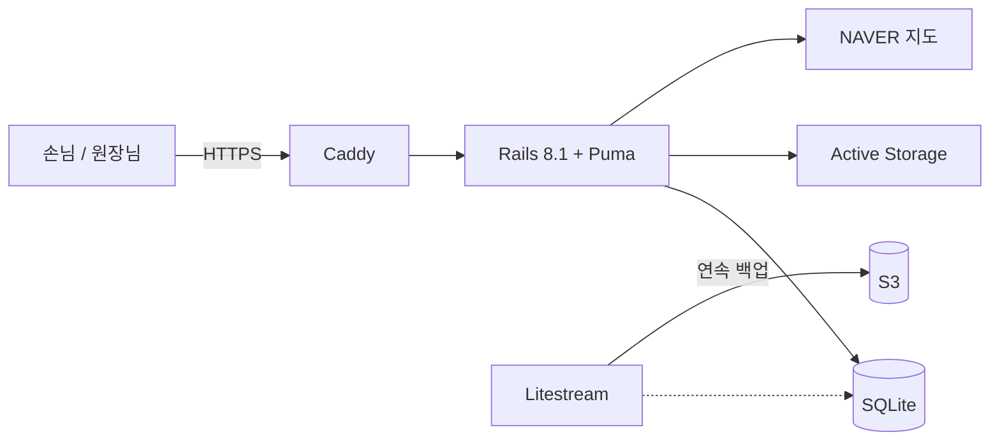

# 은파미용실 홈페이지

**43년 경력 원장님이 직접 해 주는 동네 미용실. 가격과 경력을 방문 전에 확인하고, 원장님이 코딩 없이 직접 고칠 수 있는 홈페이지.**

🔗 **데모:** 【배포 후 URL을 넣으세요】 (로컬 실행: http://localhost:3001/ko)
👤 **관리자 데모 계정:** 【읽기 전용 계정 또는 "요청 시 제공"】

  

| 모바일 홈 | 데스크톱 홈 |
|---|---|
|  |  |


*↑ 【추가 필요】 원장님이 한 화면에서 가격을 고치는 30초 GIF*

---

## 1. 무엇을 해결하는가

경북 상주 중앙시장 근처 동네 미용실 "은파미용실"은 검색하면 **주소밖에 나오지 않아**, 처음 찾는 손님이 가게를 판단할 수 없었습니다.

- **손님:** 방문 전에 가격표 · 원장님 경력(43년) · 길 안내를 확인하고 안심하고 연락한다.
- **원장님(비개발자):** 한국어 · 큰 버튼 · 한 화면 인라인 편집으로 가격과 블로그를 직접 수정한다.
- **주 고객층 40~70대 여성**을 위해 큰 글씨(본문 18px 이상) · 큰 버튼(48px 이상) · 명도 대비 4.5:1을 지키고, 한국어 · 영어 · 일본어 3개 언어를 지원합니다.

## 2. 주요 기능

| 화면 | 기능 |
|---|---|
| 홈 | 첫 문구, 가격표, 미용실 소개, 최근 블로그, 영업시간·휴무·주차, 이벤트 배너 |
| 미용실 소개 / 블로그 | 원장님 인사말(방문마다 무작위 1개), 경력, 계절별 모발 관리 글 |
| 찾아오시는 길 | 네이버 지도·내비 안내, 전화·카카오톡 버튼 |
| 관리자 `/admin` | 가격표 인라인 편집·순서 변경·숨기기, 블로그 작성, 사이트 설정, 이벤트, 휴지통 복구 |
| 공통 | `/ko` `/en` `/ja`, 모바일 하단 고정 바, 클릭 수 집계(개인정보 저장 없음), JSON-LD · sitemap · hreflang |

**의도적으로 만들지 않은 것:** 자체 예약·후기·쿠폰 기능. 개인정보 취급과 운영 부담을 피하고 **네이버 예약·플레이스·쿠폰**을 활용합니다.

## 3. 기술 선택과 이유

Ruby 3.4 / Rails 8.1 (Hotwire) · 순수 CSS · SQLite · Solid Queue/Cache/Cable (Redis 없음) · Docker · GitHub Actions

| 후보 | 결정 | 이유 |
|---|---|---|
| Rails + Hotwire | 채택 | SEO·초기 속도에 유리, 관리자 인라인 편집(Turbo Stream)에 적합 |
| SPA (React 등) | 불채택 | 페이지 수가 적어 번들러·API 분리 비용에 비해 이점이 적음 |
| SQLite (WAL) | 채택 | 쓰기 주체가 원장님 1명, 1GB 서버에서 운영이 단순 |
| PostgreSQL | 불채택 | 이 규모에서는 메모리·운영 부담이 큼 (동시 쓰기가 늘면 전환 검토) |
| 자체 예약·후기·쿠폰 | 불채택 | 개인정보 취급·운영 부담. 네이버 서비스 활용 |

상세한 이유와 대안은 [기술 결정 기록](docs/decisions.md)에 있습니다.



## 4. 사업 관점 (가설 → 시책 → 계측 → 개선)

| 단계 | 내용 | 상태 |
|---|---|---|
| 가설 | 가격과 경력을 방문 전에 공개하면 처음 찾는 손님의 불안이 줄어 연락·방문이 늘어난다 | - |
| 경쟁 분석 | 반경 2km 미용실 【N】곳의 가격·강점 비교 → 가격과 강점 표현의 근거 ([planning.md 부록](docs/planning.md)) | 【조사 중 / 완료】 |
| 시책 | 네이버 플레이스 운영 · 네이버 쿠폰(커트·파마 할인, 증정품) · 인스타그램 링크 | 【시험 운영 전 / 중】 |
| 계측 | UTM 유입 경로별 방문 수 + 전화·길 찾기 클릭 수 + 「어떻게 알고 오셨어요?」 수기 기록 (**개인 식별 정보 저장 없음**) | 클릭 집계 구현 완료 / UTM 【구현 예정】 |
| 결과 | 【실측값만 기재. 예: ○월 ○일~○일, 유입 ○건, 전화 클릭 ○건, 신규 내점 ○건】 | 【배포 후】 |
| 개선 | 【결과를 보고 바꾼 점과 전후 비교】 | 【배포 후】 |

경쟁 전략: 대형·신규 미용실의 인테리어·트렌드로 겨루지 않고, **43년 경력 · 원장 직접 시술 · 중장년 고객 · 가격 공개**의 신뢰에 집중합니다. (전체 전략표: [planning.md](docs/planning.md))

## 5. 테스트와 품질

- Minitest 93건 (번역 일관성 테스트 포함: ko/en/ja의 키·`%{변수}` 일치, 공개 화면 한글 직접 입력 금지)
- RuboCop · Brakeman · bundler-audit · GitHub Actions(CI)
- 접근성 규칙은 [CLAUDE.md](CLAUDE.md) 참고
- 모바일 Lighthouse: 【성능 ○ / 접근성 ○ / SEO ○ / 권장사항 ○ (측정일)】
- 커버리지: 【○%】

## 6. 실행 방법

Docker Desktop만 있으면 됩니다.

```bash
cp .env.example .env          # 관리자 계정 등을 반드시 직접 설정 (.env는 저장소에 올리지 않음)
docker compose up -d --build  # DB 생성·마이그레이션·시드 자동 실행
```

- 손님 화면: http://localhost:3001/ko / 관리자: http://localhost:3001/admin
- 테스트와 전체 검사: `docker compose exec -e RAILS_ENV=test web bin/rails test` / `bin/verify`
- 다른 컴퓨터로 옮길 때는 DB 파일(`storage/*.sqlite3`)과 업로드 이미지가 들어 있는 `storage/` 폴더를 통째로 함께 옮겨야 합니다. (GitHub에는 올라가지 않습니다)

## 7. 알려진 제한과 과제

- 영어·일본어 번역은 **초안**이며 공개 전 전문 검수가 필요합니다.
- 배포 전이라 신규 고객 확보 효과는 아직 검증하지 못했습니다. (측정 방법은 4장)
- 무료 서브도메인(DuckDNS)은 정식 운영 시 독립 도메인으로 교체합니다.
- Litestream은 DB만 백업합니다. 업로드 이미지 백업은 【해결 방법과 상태】 ([operations](docs/operations.md))

## 8. 문서

| 문서 | 내용 |
|---|---|
| [docs/planning.md](docs/planning.md) | 기획 기록 (과제, 사용자, 경쟁, 가치, 우려사항, 사업 관점) + 상주시 가격 조사 |
| [docs/decisions.md](docs/decisions.md) | 기술 선택 기록 (ADR 11건) |
| [docs/operations.md](docs/operations.md) | 장애 대응 · 복원 테스트 · 메모리 측정 · 설정 절차 · 서버 비용 |
| [docs/development.md](docs/development.md) · [CLAUDE.md](CLAUDE.md) | 자동 검증 · AI 활용 기록 · 이미지 출처 · 작업 규칙 |

---

> 작성: 【이름】 / GitHub: 【URL】 / 블로그(Zenn·Qiita 등): 【URL】 / 日本語版: [README.ja.md](README.ja.md) 【작성 예정】
