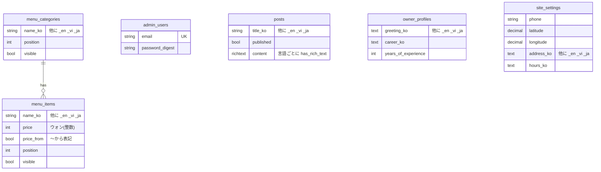

# 恩波（ウンパ）美容室ホームページ

**40〜70代のお客様が迷わず使えて、非エンジニアの院長が自分で更新できる、町の美容室のためのホームページ。**

🔗 **デモ：** 未公開（配備先のサーバー・ドメインが決まり次第、追記します）

---

# 0. このリポジトリを初めて見る方へ（概要）

## 何を作ったか
町の美容室（院長の経歴30年以上）のホームページです。紹介・料金表・ブログ・アクセス（ナビ連携）を、**韓国語・英語・ベトナム語・日本語の4言語**で提供します。
コードを書けない院長が、料金・記事・写真・営業時間を**日本語ではなく韓国語の管理画面**から、**大きなボタンと1画面のその場編集**で直せることを設計の中心にしています。

## 主な機能（実装済み）
| 画面 | できること |
|---|---|
| ホーム | 店のキャッチコピー、料金・ブログ・アクセスへの入口、スマホでは画面下に「電話する／道案内」の固定バー |
| 料金表 | カテゴリ（カット・パーマ等）ごとの施術と価格（`30,000ウォン` 形式、「〜から」表記に対応） |
| ブログ | 公開済みの記事一覧と本文。代表画像つき。翻訳がない言語では韓国語を表示し、その旨を案内 |
| 院長紹介 | あいさつ・経歴、院長の写真（未登録なら仮のイラスト）、店内写真を複数枚 |
| アクセス | 住所のコピー、駐車・入口の案内、NAVER 地図、「NAVER ナビで道案内」ボタン（アプリ→Webの順にフォールバック） |
| 管理画面 `/admin` | 料金のその場編集（ページ遷移なし）、並び替え、表示／非表示、記事の作成、サイト設定（電話・住所・座標・営業時間・休業日） |
| SEO | ページごとの title/description、OG タグ、`hreflang`（4言語＋x-default）、`/sitemap.xml`、`/robots.txt` |

## 設計上の判断（なぜそうしたか）
- **主な利用者は40〜70代の女性。** 本文18px以上・見出し24px以上・行間1.8・ボタン高さ48px以上、文字と背景のコントラストは WCAG AA（4.5:1）以上。色は CSS 先頭の `:root` 変数だけを使います。自動スライドや凝ったアニメーションは入れません。
- **管理画面は韓国語固定で、言語切替なし。** 使うのは院長だけなので、迷う要素を増やしませんでした。公開ページだけ `/:locale/...`（`ko` `en` `vi` `ja`）です。
- **翻訳は2層に分離。** 固定文言は `config/locales/*.yml` だけに置き、ビューへの直書きは禁止。DBの内容は `_ko/_en/_vi/_ja` の列と `Translatable` で持ち、**空欄なら韓国語にフォールバック**します。翻訳が間に合わなくても画面が壊れません。
- **番号や住所をコードに書かない。** 住所・電話・座標・営業時間は `SiteSetting`（管理画面で編集）にあります。
- **価格は整数（ウォン）で保存、表示は `format_price`。** 表記ゆれと計算誤差を避けるためです。
- **画像は入口と出口で守る。** アップロード時に形式・サイズを検証（`ImageValidation`）し、保存時に長辺1600pxへ自動縮小（`ImageOptimization`）します。低スペックのサーバーでも重くなりません。
- **その場編集は Turbo Stream。** 保存してもページが動かず、失敗時は 422 でエラー表示します（`Admin::MenuItemsController`）。
- **翻訳の品質を過信しない。** 英語・ベトナム語・日本語の文言とシードは**翻訳の草稿**です。公開前にネイティブまたは専門家の校閲が必要、と明記しています。
- **ガードレールを自動化。** 秘密ファイルや既存マイグレーションの編集を hook で止め、翻訳キー漏れ・`%{変数}` 不一致・ビューへの韓国語直書きをテストで検出します（[docs/harness.md](docs/harness.md)）。

## 技術スタック
| 区分 | 内容 |
|---|---|
| 言語・FW | Ruby / Ruby on Rails 8.1（Hotwire: Turbo・Stimulus） |
| UI | フレームワークなしの純粋な CSS（`app/assets/stylesheets`）、importmap |
| DB・保存 | PostgreSQL、Active Storage（画像）、Action Text（ブログ本文） |
| 認証 | `has_secure_password`（bcrypt）、ログイン試行の回数制限 |
| テスト | Rails 標準（Minitest）、翻訳一貫性テスト |
| 品質 | RuboCop（omakase）、Brakeman、`bin/verify`、GitHub Actions（CI） |
| 開発環境 | Docker Compose（web＋PostgreSQL） |
| 公開 | 未定（低コスト運用想定。[docs/gcp-low-cost.md](docs/gcp-low-cost.md)） |

## テーブル構成（ER図）

`owner_profiles` と `site_settings` は常に1件だけ。`posts` の画像・院長写真・店内写真は Active Storage です。

## ローカルでの動かし方（Docker）
```bash
cp .env.example .env        # 任意：管理者アカウントや NAVER 地図キーを変えたいとき
docker compose up
```
初回はイメージ作成 → DB 作成 → マイグレーション → シードまで自動で進みます。

| URL | 説明 |
| --- | --- |
| http://localhost:3001 | ホームページ（ブラウザの言語に応じて `/ko` などへ移動） |
| http://localhost:3001/admin | 管理画面 |

- ポートを変えるには `.env` に `WEB_PORT=3300` のように書きます（既定 3001。別プロジェクトの 3000 番と重ならないようにしています）。
- すでに `docker compose up` でサーバーが動いているので、同じコンテナで `bin/dev` を重ねて実行しても「A server is already running」で終了します。再起動は `docker compose restart web` です。
- データを初期状態に戻す：`docker compose down -v`（DB とアップロード画像がすべて消えます）

### Docker なしで動かす
Ruby 3.2 以上と PostgreSQL が必要です（libvips があると画像を自動縮小、なければ原本のまま）。
```bash
bundle install
bin/rails db:prepare db:seed
bin/rails server
```

## テストと品質チェック
```bash
bin/verify                                                       # RuboCop + Brakeman + テスト + 翻訳漏れ検査
bin/rails test                                                   # テストのみ
bin/rails test test/integration/admin_menu_flow_test.rb          # 単体
docker compose run --rm -e RAILS_ENV=test web bin/rails db:prepare test   # Docker 内で
```
`test/i18n_consistency_test.rb` が、4言語のキー漏れ・`%{変数}` の不一致・公開ビューへの韓国語直書きを検出します。CI（GitHub Actions）でも push / PR ごとに実行します。

## 既知の制限と今後の課題
- ブログ本文エディタ（Trix）に貼る画像は、代表画像ほど厳しく形式・サイズを検証していません（管理者のみ使用）。
- 管理者は1人で使う前提です（同時編集の競合処理なし）。
- Web フォントは Google Fonts を使用。外部通信が問題なら `app/assets/fonts` に置いて `@font-face` へ差し替えます。
- Ruby 3.2 は2026-03にサポート終了。公開前に `.ruby-version` と `Dockerfile` の `RUBY_VERSION` を上げる予定です。
- 事業者情報・個人情報処理方針はフッター領域のみ（処理方針ページは「準備中」）。
- 配備設定（サーバー・ドメイン）は未作成。必要な値は環境変数だけに分けてあります。

---

# ここから先は、運用手順と企画・設計の記録です

# 1. 運用ガイド

## 1-1. 管理者アカウント
- 最初の管理者は `db:seed` 実行時に、環境変数 `ADMIN_EMAIL` / `ADMIN_PASSWORD` から**一度だけ**作られます。
- 開発環境で値がなければ `admin@example.com` / `change-me-please` で作成されます。**本番では必ず変更してください。**
- 本番では、2つの環境変数がなければアカウントを作りません。
- パスワードは bcrypt でハッシュ化。ログイン後 `/admin` →「パスワード変更」で変更できます。
- 忘れた場合：
  ```bash
  docker compose exec web bin/rails runner 'AdminUser.first.update!(password: "新しいパスワード8文字以上")'
  ```

## 1-2. 管理画面でできること
| メニュー | 内容 |
| --- | --- |
| 料金（メニュー・価格） | カテゴリ／施術の追加・削除、1画面で名前・価格をその場修正、上下の並び替え、表示／非表示、「〜から」表記 |
| ブログ | 記事の作成・編集・削除、公開／非公開、代表画像、本文（Action Text） |
| 院長紹介 | あいさつ・経歴、院長写真、店内写真（複数） |
| サイト設定 | 電話、住所、地図座標（緯度／経度）、営業時間、休業日、駐車・入口案内、事業者情報 |

価格は数字だけを保存し、画面には `30,000ウォン` の形で表示されます。

## 1-3. NAVER 地図キーの設定
1. [NAVER Cloud Platform](https://www.ncloud.com) → Application Services → **Maps** でアプリケーションを登録します。
2. 利用 API で **Dynamic Map** を選び、「Web サービス URL」にサイトのURLを登録します。開発中は `http://localhost:3001` も登録してください。
3. 発行された **Client ID** を `.env` の `NAVER_MAP_CLIENT_ID` に入れ、サーバーを再起動します。
4. `/admin` → サイト設定で、**緯度／経度**を実際の店舗位置に直します。

キーがない、または地図の読み込みに失敗したときは、地図の代わりに案内文と「NAVER 地図で見る」ボタンを表示します。

**「NAVER ナビで道案内」ボタンの動き**
- モバイル：NAVER 地図アプリの URL スキーム（`nmap://navigation?...`）でアプリを開き、約1.8秒で開かなければ NAVER 地図の Web へ移動します。
- PC：NAVER 地図 Web（住所検索）を新しいウィンドウで開きます。
- `NAVER_APP_NAME` は URL スキームの `appname` 値です。サービスのドメインを逆にした値（例：`kr.co.example`）を推奨します。

## 1-4. 多言語（翻訳）の管理
- **固定文言**（メニュー・ボタン・案内）：`config/locales/ko.yml` `en.yml` `vi.yml` `ja.yml`。同じキーを4ファイルで直します。未翻訳のキーは自動で韓国語表示になります。
- **DB の内容**（施術名・ブログ・紹介・サイト設定）：管理画面の各入力欄の下の **「他の言語の翻訳を入力する」** を開いて入力。空欄なら韓国語が表示され、ブログと紹介ページには「韓国語で表示しています」の案内が出ます。
- **新しい言語の追加（例：中国語 `zh`）**
  1. `config/application.rb` の `config.i18n.available_locales` に `:zh`
  2. `config/locales/zh.yml` を作成（`en.yml` をコピーして翻訳）
  3. `config/routes.rb` の `locale: /ko|en|vi|ja/` に `zh`
  4. `app/models/concerns/translatable.rb` の `LOCALES` に `:zh`
  5. `name_zh` `title_zh` `description_zh` `address_zh` … の翻訳列を**新しいマイグレーション**で追加
  6. `ApplicationHelper::LOCALE_CODES` に `zh: "ZH"`、管理画面フォーム（`app/views/admin/**`）に入力欄を追加

> ⚠️ **翻訳の校閲について**：シードと `config/locales` の英語・ベトナム語・日本語は**翻訳の草稿**です。公開前に必ずネイティブまたは専門の翻訳者の校閲を受けてください（特に価格、営業時間、個人情報処理方針）。

## 1-5. 構成の概要
```
app/models/            MenuCategory, MenuItem, Post, OwnerProfile(1件), SiteSetting(1件), AdminUser
app/models/concerns/   Translatable(言語フォールバック), Positionable(並び替え), ImageValidation, ImageOptimization
app/controllers/       公開ページ / admin/*(管理画面)
app/javascript/controllers/   nav(ハンバーガー), copy(住所コピー), navi(ナビ連携), naver_map(地図)
config/locales/        固定文言 4言語
db/seeds.rb            仮の料金・紹介・住所・ブログ例文(翻訳草稿を含む)
```
- 翻訳列の規則：`name_ko / name_en / name_vi / name_ja` → モデルの `name` が現在の言語の値を返し、空なら韓国語。
- 並び順：`position` 列。上下ボタンで隣と入れ替え。
- ブログ本文：言語ごとに `has_rich_text :content_ko, :content_en, ...`

## 1-6. 環境変数
`.env.example` を参照。配備先が決まったら、サーバーに同じ名前の環境変数を設定します。

| 変数 | 説明 |
| --- | --- |
| `ADMIN_EMAIL`, `ADMIN_PASSWORD` | 最初の管理者アカウント |
| `NAVER_MAP_CLIENT_ID` | NAVER 地図の Client ID |
| `NAVER_APP_NAME` | NAVER 地図アプリ URL スキームの appname |
| `APP_BASE_URL` | サイトのURL（sitemap・canonical・OG）。空ならリクエストのURL |
| `UPLOAD_MAX_MB` | アップロード画像の最大サイズ（既定 5） |
| `IMAGE_MAX_EDGE`, `IMAGE_QUALITY` | 画像の自動縮小（既定 1600px・品質 82） |
| `RAILS_MAX_THREADS`, `WEB_CONCURRENCY`, `RAILS_YJIT` | 省メモリ用（既定 3, 0, false） |
| `DATABASE_URL` | 本番 DB の接続文字列 |
| `FORCE_SSL` | 本番で HTTPS を強制するか（既定 true） |

## 1-7. アクセシビリティ・SEO・セキュリティ
- 本文18px／見出し24px以上／ボタン48px以上、モバイル下部の固定バー、自動スライド・複雑なアニメなし
- コントラスト WCAG AA 以上（CSS 先頭のコメントに計算値）、キーボードのフォーカス表示、本文へのスキップリンク
- ページ別 title/description、OG、`hreflang`、`/sitemap.xml`、`/robots.txt`
- CSRF 対策、管理者認証（セッション再発行・ログイン試行制限）、パスワードは bcrypt、アップロードは JPG/PNG/WEBP/GIF・5MB以下のみ
- 日本語（`/ja`）で横スクロールが出ないことを確認（`word-break: keep-all` は韓国語のみ）

## 1-8. 低コストサーバー（例：Google Cloud e2-micro）
画像の自動縮小と省メモリ設定（YJIT 既定オフ、Puma ワーカー0）が入っています。料金の防御チェックリストとスワップ設定は [docs/gcp-low-cost.md](docs/gcp-low-cost.md) を参照。

## 1-9. 開発ハーネス（Claude Code）
`CLAUDE.md`、`.claude/`、`bin/verify` に作業ルールと自動検証があります。詳しくは [docs/harness.md](docs/harness.md)。

---

# 2. サービス概要

## どんなサービスか
町の美容室が、料金と場所と人柄を、**電話をかける前に安心して確かめられる**ホームページ。そして院長が**自分の手で、迷わず更新できる**仕組み。

## 誰の課題をどう解決するか
**対象：** 40〜70代の女性のお客様と、コードを書けない院長。

**解決策：**
1. 文字は大きく、色のコントラストは高く、ボタンは押しやすく。スマホでは「電話する／道案内」をいつでも画面下に出し、迷わず連絡・来店できるようにします。
2. 管理画面は韓国語・大きなボタン・1画面のその場編集にして、料金改定や休業のお知らせを院長ご自身が数十秒で直せるようにします。

# 3. 想定ユーザーについて

## 3-1. ペルソナ
| 誰 | 状況 | 求めること |
|---|---|---|
| お客様（40〜70代の女性） | スマホで「料金」「場所」「営業時間」を確認してから電話・来店する | 小さな文字や複雑な操作なしで、知りたい情報にすぐ着く |
| 院長 | 日中は施術で手が離せず、PC操作に不慣れ | 難しい用語なしで、料金や営業時間をその場で直せる |
| 外国語のお客様 | 英語・ベトナム語・日本語で店を調べる | 自分の言語で料金と道順が分かる |

## 3-2. 本当に解決したい課題
表面の困りごとは「古い情報が載っている」「地図が分かりにくい」ですが、本質は**更新が面倒で、情報が古くなり、お客様の不安になること**です。更新の手間を減らすこと（管理画面の設計）が、お客様への価値に直結します。

# 4. 設計の記録（なぜこの形にしたか）

## 4-1. 管理画面は「簡単さ」を最優先
- 保存してもページが動かない Turbo Stream のその場編集（失敗時は 422 で理由を表示）
- 並び替えはドラッグではなく「上へ／下へ」ボタン（確実に押せる）
- 「見せない」を削除と分け、`visible` で非表示にできる（誤削除の不安を減らす）

## 4-2. 翻訳は「完璧でなくても壊れない」
- 翻訳の列は空欄を許し、空なら韓国語。4言語を一度に埋める必要はありません。
- その代わり、固定文言のキー漏れは**テストで検出**します（空欄の許容は DB の内容だけ）。

## 4-3. 守るルール
- 秘密ファイル（`.env`、`config/master.key`）には触れない・コミットしない
- 作成済みのマイグレーションは編集せず、新しいものを足す
- テストを消したり弱めたりして通さない
- 英語・ベトナム語・日本語の翻訳を「最終」と言わない（常に「草稿・専門家の校閲が必要」）

# 5. 今後の展開
- 配備（サーバー・ドメインの決定後）と、公開後のアクセス確認
- 翻訳の校閲、個人情報処理方針ページの整備
- ブログ本文内の画像の検証強化、複数管理者への対応

# 6. 技術選定の理由
Ruby on Rails（Hotwire）は、少ないコードで管理画面とデータ管理を作れ、Turbo による部分更新で「その場編集」を JavaScript の自前実装なしに実現できます。CSS はフレームワークを使わず、アクセシビリティの数値（文字サイズ・コントラスト・ボタン高さ）を変数で一元管理しています。Docker でどのPCでも同じ環境が動きます。
