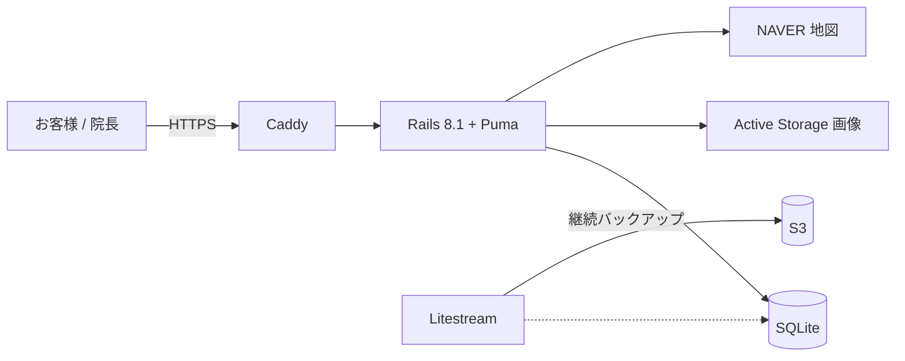

# 恩波美容室（ウンパ美容室）ホームページ

## 1. プロジェクト名・概要

**恩波美容室ホームページ** — 韓国・慶尚北道 尚州（サンジュ）市の街の美容室のための公式サイトです。
お客様は来店前に料金表・場所・営業時間を確認でき、院長（ITに不慣れな方）は韓国語の管理画面から自分で内容を更新できます。

> **30秒サマリー**
> - **課題:** 検索しても住所しか出てこない街の美容室の情報不足と、更新のたびに業者へ依頼する手間・費用
> - **解決:** 料金表・経歴・道案内を公開し、院長が1画面で直接編集できる管理画面を提供
> - **技術:** Ruby 3.4 · Rails 8.1 (Hotwire) · SQLite + Litestream · Docker · GitHub Actions / 韓国語・英語・日本語に対応
> - **現状:** 開発・テスト完了（テスト95件）。**サーバーへのデプロイと、実際の S3 での復元テストは未実施です。**

## 2. デモ・スクリーンショット

| モバイル ホーム | デスクトップ ホーム |
|---|---|
|  |  |

- **デモ URL:** まだサーバーにデプロイしていません（未デプロイ）。ローカルでの起動は「9. 環境構築・起動方法」を参照してください。
- 管理画面はセキュリティ上公開していません。面接では画面共有でご覧いただけます。

## 3. 開発背景・目的

尚州中央市場の近くにある美容室は、検索しても**住所しか表示されず**、初めて来る方が店の様子を判断できませんでした。

- **お客様（40〜70代の女性）:** 料金表・経歴・道案内を見て、安心して電話できる。
- **院長（コードが分からない）:** 料金やブログを自分で直せる必要がある。業者に頼むと更新のたびに費用がかかる。
- **開発者（1人で運用）:** 費用がほとんどかからず、止まらず、壊れても復旧できる必要がある。

**あえて作らなかったもの:** 独自の予約・口コミ・クーポン機能。個人情報の取り扱いと運用の負担を避け、NAVER 予約・NAVER プレイスと連携します。

## 4. 主な機能

| 区分 | 機能 |
|---|---|
| 公開画面 | ホーム（料金表・営業時間・定休日・駐車場）、美容室紹介（院長のあいさつをランダム表示）、ブログ、アクセス（NAVER 地図・ナビ）、プライバシーポリシー |
| 管理画面 `/admin` | 料金表のインライン編集・並べ替え・非表示、ブログ作成、サイト設定（住所・電話・営業時間）、お知らせバナー、ゴミ箱からの復元、ボタンのクリック数の確認 |
| 多言語 | `/ko` `/en` `/ja`（英語・日本語は草稿） |
| 検索・アクセシビリティ | JSON-LD（HairSalon）・sitemap・hreflang、大きな文字・大きなボタン、モバイル下部の固定メニュー |
| その他 | 経験年数の自動計算（開始年から算出）、NAVER 予約ボタン（URL を入力すると表示） |

## 5. 使用技術・技術選定理由

| 選択 | 理由 | 採用しなかった代替案 |
|---|---|---|
| Rails 8.1 + Hotwire | ページ数が少なく SEO が重要。管理画面のインライン編集に Turbo Stream が適している | SPA（React など）: バンドラや API 分離のコストに見合う利点が小さい |
| SQLite | 書き込むのは院長1人。メモリ 1GB のサーバーでも運用が単純。Redis なしで Solid Queue/Cache/Cable を使える | PostgreSQL: この規模ではメモリ・運用の負担が大きい（同時書き込みが増えたら移行を検討） |
| Litestream → AWS S3 | DB を継続的に複製（損失は最大約10秒）。コンテナ起動時に自動復元 | 日次ダンプ: 損失の範囲が大きい |
| Docker + Caddy | 1台のサーバーで HTTPS を自動取得。サーバーではビルドせず GitHub Actions でビルド | Kamal・Kubernetes: サーバー1台には過剰 |
| 純粋な CSS + Minitest | アクセシビリティの数値（文字サイズ・コントラスト）を変数で一元管理。依存を最小限に | CSS フレームワーク・RSpec |
| 自作の管理画面 | 院長専用の UI（1画面でインライン編集） | Web ビルダー（比較のうえ決定） |

各決定の背景と詳細: [docs/decisions.md](docs/decisions.md)（韓国語・日本語混在）

## 6. システム構成・DB設計



**主なテーブル:** `menu_categories` → `menu_items`（価格は整数のウォン）、`posts`、`owner_profiles` → `owner_greetings`、`site_settings`（住所・電話・座標・営業時間）、`events`、`click_events`（個人情報を含まないクリック集計）

- 翻訳する項目は `_ko / _en / _ja` の列と `Translatable` モジュールで管理（空なら韓国語で代替表示）
- 削除はすべて論理削除（`discard!`）で、ゴミ箱から復元できます

## 7. 工夫した点・技術的課題

**① 偽装画像のアップロードによるサーバーエラー**
- 問題: 拡張子だけが画像のファイルをアップロードすると 500 エラーになりました。
- 原因: ブラウザが申告するファイル形式をそのまま信用していました。
- 対応: ファイルの中身（マジックバイト）で検証し、拒否したアップロードはフォームに安全に再表示するよう修正しました。
- 結果: 同じ状況を再現するテストを追加しました。

**② ファイル DB のバックアップと復元**
- 問題: SQLite はファイル1つのため、ディスクが消えるとデータも消えます。
- 対応: Litestream で S3 へ継続的に複製し、コンテナ起動時に DB がなければ自動で復元するようにしました。
- 結果: ローカルの Docker で「ディスク削除 → 再起動 → 自動復元」を確認しました。アップロード画像は Litestream の対象外で別途同期が必要ですが、現在は**未設定**です。

**③ 高齢のお客様とモバイルの最初の画面**
- 問題: 40〜70代のお客様が最初に探す「電話」「道案内」ボタンが、スマートフォンの最初の画面で見えにくい状態でした。
- 対応: ロゴと余白を縮め、ボタンを低くして、iPhone の画面で最初に電話・道案内・予約の3ボタンが見えるようにしました。本文 18px・ボタン 48px・コントラスト 4.5:1 の基準は維持しています。

**④ メモリ 1GB のサーバー**
- コンテナのメモリ上限を 700MB にして測定したところ、起動直後は約 214MiB、1,000 リクエスト後は約 266MiB でした。Litestream のプロセスは別に +20〜40MB と見積もっており、本番設定での再測定が必要です。

**⑤ 翻訳漏れと古くなる数字**
- 翻訳キー・`%{変数}` の不一致や、公開画面への韓国語の直書きを、テストが自動で検出します。
- 「経験43年」は固定の数字ではなく開始年から計算し、毎年自動で更新されます。

## 8. テスト・品質管理・セキュリティ

- **テスト:** Minitest 95件（翻訳の一貫性テストを含む）。変更後は `bin/verify`（RuboCop → Brakeman → テスト → 翻訳チェック）
- **CI:** GitHub Actions で RuboCop · Brakeman · bundler-audit · テストを毎回実行
- **セキュリティ:** CSP（nonce）、画像の中身の検証、クリック集計に IP・Cookie を保存しない、機密値はリポジトリに載せない（`.env`、`master.key`）、管理者ログインの試行回数制限
- **運用の検証:** 復元テスト（ローカル Docker で成功）、メモリ測定。**未実施:** 実際の S3 バケットでの復元、本番サーバーへのデプロイ
- **AI の活用:** 実装の大半を Claude Code で作成し、自動テストと自分の確認で検証しました。範囲と検証方法: [docs/development.md](docs/development.md)

## 9. 環境構築・起動方法

Docker Desktop があれば動きます。

```bash
cp .env.example .env          # 管理者アカウントなどを自分で設定（.env はリポジトリに載せない）
docker compose up -d --build  # DB 作成・マイグレーション・シードを自動実行
```

- お客様向け画面: http://localhost:3001/ko / 管理画面: http://localhost:3001/admin
- 全体の検査: `bin/verify`
- 別のコンピューターへ移すときは、DB ファイル（`db/*.sqlite3`）とアップロード画像（`storage/`）も一緒に移す必要があります。

## 10. 今後の改善点

- サーバーのデプロイ（AWS Lightsail ソウル 1GB + ドメイン）と、実際の S3 での復元テスト
- アップロード画像の日次 S3 同期の設定（Litestream は DB のみバックアップ）
- 英語・日本語の翻訳の専門的な校閲、日本語のブログ・あいさつなど DB コンテンツの翻訳
- NAVER スマートプレイスの予約の連携と、デプロイ後のクリック数による効果測定
- 独自ドメインの導入（Cloudflare を利用可能にする）

## ドキュメント

| ドキュメント | 内容 |
|---|---|
| [docs/planning.md](docs/planning.md) | 企画記録、競合・価格の調査、ビジネス視点（韓国語） |
| [docs/decisions.md](docs/decisions.md) | 技術選定の記録（ADR 11件） |
| [docs/operations.md](docs/operations.md) | 障害対応、復元テスト、メモリ測定、セットアップ手順、費用 |
| [docs/development.md](docs/development.md) · [CLAUDE.md](CLAUDE.md) | 自動検証、AI の活用、画像の出典、作業ルール（韓国語） |
