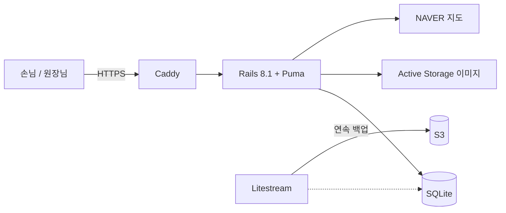

# 은파미용실 홈페이지 (恩波美容室 ホームページ)

## 1. プロジェクト名・概要

**은파미용실 홈페이지** — 경북 상주의 동네 미용실을 위한 공식 사이트입니다.
손님은 방문 전에 가격표·위치·영업시간을 확인하고, 원장님(비개발자)은 한국어 관리자 화면에서 직접 내용을 수정합니다.

> **30초 요약**
> - **과제:** 검색하면 주소밖에 나오지 않는 동네 미용실의 정보 부족, 그리고 수정할 때마다 업체에 맡겨야 하는 비용
> - **해결:** 가격표·경력·길 안내를 공개하고, 원장님이 한 화면에서 직접 고치는 관리자 화면 제공
> - **기술:** Ruby 3.4 · Rails 8.1 (Hotwire) · SQLite + Litestream · Docker · GitHub Actions / 한국어·영어·일본어
> - **현재 상태:** 개발·테스트 완료(테스트 95건). **서버 배포와 실제 S3 복원 테스트는 아직 하지 않았습니다.**

## 2. デモ・スクリーンショット

| 모바일 홈 | 데스크톱 홈 |
|---|---|
|  |  |

- **데모 URL:** 아직 서버에 배포하지 않았습니다(未デプロイ). 로컬 실행은 9번 참고.
- 관리자 화면은 보안상 공개하지 않으며, 면접 시 화면 공유로 보여 드릴 수 있습니다.

## 3. 開発背景・目的

경북 상주 중앙시장 근처의 미용실은 검색해도 **주소밖에 나오지 않아**, 처음 온 손님이 가게를 판단할 수 없었습니다.

- **손님(40~70대 여성):** 가격표·경력·길 안내를 보고 안심하고 전화한다.
- **원장님(코딩을 모름):** 가격이나 블로그를 직접 고칠 수 있어야 한다. 업체에 맡기면 수정할 때마다 비용이 든다.
- **개발자(1인 운영):** 비용이 거의 들지 않고, 멈추지 않고, 망가져도 복구할 수 있어야 한다.

**의도적으로 만들지 않은 것:** 자체 예약·후기·쿠폰 기능. 개인정보 취급과 운영 부담을 피하고 네이버 예약·플레이스를 연결합니다.

## 4. 主な機能

| 구분 | 기능 |
|---|---|
| 공개 화면 | 홈(가격표, 영업시간, 휴무, 주차), 미용실 소개(원장님 인사말 무작위 표시), 블로그, 찾아오시는 길(네이버 지도·내비), 개인정보 처리방침 |
| 관리자 `/admin` | 가격표 인라인 편집·순서 변경·숨기기, 블로그 작성, 사이트 설정(주소·전화·영업시간), 이벤트 배너, 휴지통 복구, 버튼 클릭 수 확인 |
| 다국어 | `/ko` `/en` `/ja` (영어·일본어는 초안) |
| 검색·접근성 | JSON-LD(HairSalon)·sitemap·hreflang, 큰 글씨·큰 버튼, 모바일 하단 고정 메뉴 |
| 기타 | 경력 년수 자동 계산(시작 연도 기준), 네이버 예약 버튼(주소 입력 시 표시) |

## 5. 使用技術・技術選定理由

| 선택 | 이유 | 채택하지 않은 대안 |
|---|---|---|
| Rails 8.1 + Hotwire | 페이지가 적고 SEO가 중요. 관리자 인라인 편집에 Turbo Stream이 적합 | SPA(React 등): 번들러·API 분리 비용에 비해 이점이 적음 |
| SQLite | 쓰는 사람이 원장님 1명. 1GB 서버에서 운영이 단순. Redis 없이 Solid Queue/Cache/Cable | PostgreSQL: 이 규모에서는 메모리·운영 부담이 큼 (동시 쓰기가 늘면 전환 검토) |
| Litestream → AWS S3 | DB 연속 복제(손실 최대 약 10초). 컨테이너 시작 시 자동 복원 | 일일 덤프: 손실 범위가 큼 |
| Docker + Caddy | 1대 서버에서 HTTPS 자동 발급. 서버에서 빌드하지 않고 GitHub Actions에서 빌드 | Kamal·Kubernetes: 서버 1대에는 과함 |
| 순수 CSS + Minitest | 접근성 수치(글씨·대비)를 변수로 한곳에서 관리, 의존성 최소화 | CSS 프레임워크·RSpec |
| 자체 관리자 | 원장님 전용 UI(한 화면 인라인 편집) | 웹 빌더(비교 후 결정) |

각 결정의 배경과 상세: [docs/decisions.md](docs/decisions.md)

## 6. システム構成・DB設計



**주요 테이블:** `menu_categories` → `menu_items`(가격은 정수 원 단위), `posts`, `owner_profiles` → `owner_greetings`, `site_settings`(주소·전화·좌표·영업시간), `events`, `click_events`(개인정보 없는 클릭 집계)

- 번역 필드는 `_ko / _en / _ja` 컬럼 + `Translatable` 모듈(비어 있으면 한국어로 대체)
- 삭제는 모두 논리 삭제(`discard!`)이며 휴지통에서 복구

## 7. 工夫した点・技術的課題

**① 가짜 이미지 업로드로 서버 오류**
- 문제: 확장자만 이미지인 파일을 올리면 500 오류가 났습니다.
- 원인: 브라우저가 알려 주는 파일 형식을 그대로 믿고 있었습니다.
- 대응: 파일 내용(매직 바이트)으로 검증하고, 거절된 업로드는 폼에서 안전하게 다시 표시하도록 수정했습니다.
- 결과: 같은 상황을 재현하는 테스트를 추가했습니다.

**② 파일 DB의 백업과 복원**
- 문제: SQLite는 파일 하나라서, 디스크가 사라지면 데이터도 함께 사라집니다.
- 대응: Litestream으로 S3에 연속 복제하고, 컨테이너 시작 시 DB가 없으면 자동으로 복원하게 했습니다.
- 결과: 로컬 Docker에서 "디스크 삭제 → 재시작 → 자동 복원"을 확인했습니다. 업로드 이미지는 Litestream 대상이 아니라서 별도 동기화가 필요하며, 현재 **미설정**입니다.

**③ 시니어 손님과 모바일 첫 화면**
- 문제: 40~70대 손님이 가장 먼저 찾는 전화·길 찾기 버튼이 휴대폰 첫 화면에서 잘 보이지 않았습니다.
- 대응: 로고와 여백을 줄이고 버튼을 낮춰, 아이폰 기준 첫 화면에서 버튼 3개가 보이도록 조정했습니다. 본문 18px·버튼 48px·대비 4.5:1 기준은 유지했습니다.

**④ 1GB 서버에서의 메모리**
- 컨테이너 메모리 상한 700MB로 측정한 결과 시작 직후 약 214MiB, 1,000 요청 후 약 266MiB였습니다. Litestream 프로세스는 별도로 +20~40MB로 추정하며 운영 설정에서 다시 측정해야 합니다.

**⑤ 번역 누락과 오래된 숫자**
- 번역 키·`%{변수}` 불일치와 공개 화면의 한글 직접 입력을 테스트가 자동으로 검출합니다.
- "43년 경력"은 고정 숫자가 아니라 시작 연도에서 계산해 매년 자동으로 갱신됩니다.

## 8. テスト・品質管理・セキュリティ

- **테스트:** Minitest 95건(번역 일관성 테스트 포함). 변경 후 `bin/verify`(RuboCop → Brakeman → 테스트 → 번역 검사)
- **CI:** GitHub Actions에서 RuboCop · Brakeman · bundler-audit · 테스트를 매번 실행
- **보안:** CSP(nonce), 이미지 내용 검증, 클릭 집계에 IP·쿠키 미저장, 비밀 값은 저장소에 올리지 않음(`.env`, `master.key`)
- **운영 검증:** 복원 테스트(로컬 Docker 성공), 메모리 측정. **未実施:** 실제 S3 버킷에서의 복원, 실제 서버 배포
- **AI 활용:** 구현 대부분을 Claude Code로 작성했고, 자동 테스트와 직접 확인으로 검증했습니다. 범위와 검증 방법: [docs/development.md](docs/development.md)

## 9. 環境構築・起動方法

Docker Desktop만 있으면 됩니다.

```bash
cp .env.example .env          # 관리자 계정 등을 직접 설정 (.env는 저장소에 올리지 않음)
docker compose up -d --build  # DB 생성·마이그레이션·시드 자동 실행
```

- 손님 화면: http://localhost:3001/ko / 관리자: http://localhost:3001/admin
- 전체 검사: `bin/verify`
- 다른 컴퓨터로 옮길 때는 DB 파일(`db/*.sqlite3`)과 업로드 이미지(`storage/`)도 함께 옮겨야 합니다.

## 10. 今後の改善点

- 서버 배포(AWS Lightsail 서울 1GB + 도메인)와 실제 S3 복원 테스트
- 업로드 이미지의 일일 S3 동기화 설정(Litestream은 DB만 백업)
- 영어·일본어 번역의 전문 검수, 일본어 블로그·인사말 등 DB 콘텐츠 번역
- 네이버 스마트플레이스 예약 연결, 배포 후 클릭 수 기반 효과 측정
- 독립 도메인 도입(Cloudflare 적용 가능)

## 문서

| 문서 | 내용 |
|---|---|
| [docs/planning.md](docs/planning.md) | 기획 기록, 경쟁·가격 조사, 사업 관점 |
| [docs/decisions.md](docs/decisions.md) | 기술 선택 기록(ADR 11건) |
| [docs/operations.md](docs/operations.md) | 장애 대응, 복원 테스트, 메모리 측정, 설정 절차, 비용 |
| [docs/development.md](docs/development.md) · [CLAUDE.md](CLAUDE.md) | 자동 검증, AI 활용, 이미지 출처, 작업 규칙 |

日本語版: [README.ja.md](README.ja.md)
