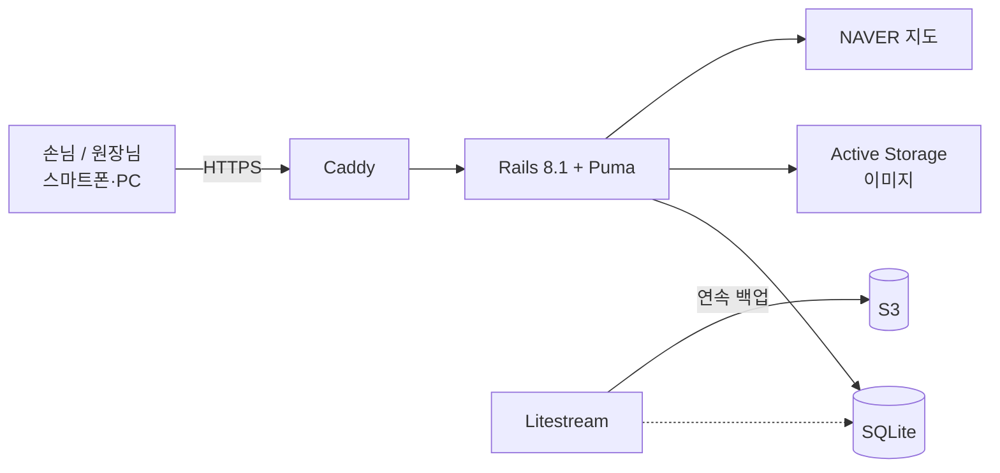
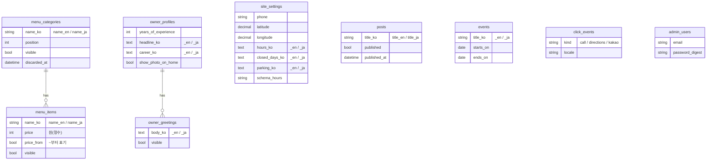

# 은파미용실 홈페이지

**43년 경력 원장님이 직접 해 주는 동네 미용실. 가격과 경력을 방문 전에 확인하고, 원장님이 코딩 없이 직접 고칠 수 있는 홈페이지.**

🔗 **데모:** 아직 배포 전입니다 (로컬 실행: http://localhost:3001/ko)

| 모바일 홈 | 데스크톱 홈 |
|---|---|
|  |  |

---

# 처음 보시는 분께 (개요)

## 서비스 소개
경북 상주 중앙시장 근처 동네 미용실 "은파미용실"의 공식 홈페이지입니다.
검색해도 주소밖에 나오지 않아 새 손님이 가게를 판단할 수 없던 문제를, **가격 공개 · 원장님 소개 · 길 안내 · 블로그**로 해결합니다. 주 고객층은 40~70대 여성이라 큰 글씨·큰 버튼·높은 명도 대비를 지키고, 한국어·영어·일본어 3개 언어를 지원합니다.

## 주요 기능 (구현 완료)
| 화면 | 기능 |
|---|---|
| 홈 | 첫 문구(후보 3개 중 선택 또는 직접 입력), 가격표, 미용실 소개, 최근 블로그, 영업시간·휴무일·주차 안내, 이벤트 배너 |
| 미용실 소개 | 원장님 인사말(여러 개 중 방문 때마다 무작위 1개), 경력 43년, 매장 사진 |
| 블로그 | 계절별 모발 관리·파마 후 관리 등 글 목록과 상세 (한국어 본문이 기본, 영어·일본어는 선택) |
| 찾아오시는 길 | 네이버 지도·네이버 내비 길 안내(키가 없으면 지도 이미지로 대체), 전화·카카오톡 상담 버튼, 영업시간·휴무일·주차 |
| 관리자(`/admin`, 한국어) | 가격표 한 화면 인라인 편집·순서 변경·숨기기, 블로그 작성, 원장님 소개, 사이트 설정(주소·전화·영업시간·주차·지도), 이벤트, 휴지통 복구 |
| 공통 | 3개 언어(`/ko` `/en` `/ja`), 모바일 하단 고정 바(전화·길 찾기), 전화·길 찾기 클릭 수 집계(개인정보 저장 없음), 구조화 데이터(JSON-LD)·sitemap·hreflang |

**의도적으로 만들지 않은 것:** 자체 예약·후기 기능 (개인정보 취급과 운영 부담을 피하고 네이버 서비스를 활용)

## 기술 스택
| 구분 | 내용 |
|---|---|
| 언어·프레임워크 | Ruby 3.4 / Ruby on Rails 8.1 (Hotwire: Turbo·Stimulus) |
| UI | 순수 CSS (프레임워크 없음, 색은 `:root` 변수에 집중), importmap, Propshaft |
| DB·저장 | SQLite (primary / cache / queue / cable), Active Storage(이미지, 자동 축소·WebP), Action Text(블로그 본문) |
| 백그라운드 | Solid Queue / Solid Cache / Solid Cable (Redis 없음) |
| 테스트 | Minitest (93건, 번역 일관성 테스트 포함) |
| 품질 | RuboCop, Brakeman, bundler-audit, GitHub Actions(CI) |
| 공개 (예정) | AWS Lightsail 서울 1GB + Caddy(자동 HTTPS) + DuckDNS + Litestream(S3 백업) |



## 테이블 구성 (ER 도면)

블로그 본문은 Action Text(`content_ko` / `content_en` / `content_ja`), 이미지는 Active Storage 테이블에 저장됩니다.

## 로컬에서 실행하는 방법
Docker Desktop만 있으면 됩니다. Ruby를 따로 설치할 필요는 없습니다.
```bash
docker compose up -d --build   # 처음 실행 시 DB 생성·마이그레이션·시드가 자동으로 진행됩니다
```
- 손님 화면: http://localhost:3001/ko (`/en`, `/ja`도 가능) / 관리자: http://localhost:3001/admin
- 개발용 임시 관리자 계정은 `admin@example.com` / `change-me-please` 입니다. **`.env`에서 반드시 바꾸세요.** (`.env.example`을 복사해서 사용, `.env`는 저장소에 올리지 않음)
- 로그 보기 `docker compose logs -f web` / 멈추기 `docker compose down`
- 다른 컴퓨터로 옮길 때는 코드 외에 **DB 파일(`db/*.sqlite3`)과 업로드 이미지(`storage/`)** 도 함께 옮겨야 입력한 내용이 그대로 보입니다. (Git에 포함되지 않음)

## 테스트와 품질 체크
```bash
docker compose exec -e RAILS_ENV=test web bin/rails test   # 테스트 93건
bin/verify                                                  # rubocop + brakeman + 테스트 + 번역 누락 검사
```
- 번역 일관성 테스트: ko/en/ja의 키와 `%{변수}`가 같은지, 공개 화면에 한글이 직접 들어 있지 않은지 검사합니다.
- CI(GitHub Actions)에서 Brakeman · bundler-audit · RuboCop · 테스트를 실행합니다.
- 접근성 규칙(본문 18px 이상, 버튼 48px 이상, 명도 대비 4.5:1)은 [CLAUDE.md](CLAUDE.md)에 있습니다.
- 【TODO】 모바일 Lighthouse 점수 측정 (성능 / 접근성 / SEO / 권장사항)

## 알려진 제한과 앞으로의 과제
- 영어·일본어 번역은 **초안**입니다. 공개 전에 전문 검수가 필요합니다.
- 아직 배포 전이라 신규 고객 확보 효과는 검증하지 못했습니다.
- 무료 서브도메인(DuckDNS)은 독립 도메인보다 신뢰감·검색 노출에서 불리할 수 있어 정식 운영 시 교체를 검토합니다.
- Litestream은 DB만 백업합니다. **업로드 이미지는 별도로 백업**해야 합니다. (운영 절차: [docs/runbook.md](docs/runbook.md), 비용: [docs/server-cost.md](docs/server-cost.md))

---

# 여기서부터는 기획·설계의 기록입니다

> `【TODO】`는 본인이 직접 쓰거나 확인해야 하는 부분, "(가정)"은 확인이 필요한 추측입니다.

# 1. 서비스 개요

## 어떤 서비스인가
어머니가 운영하는 동네 미용실의 홈페이지입니다. 가격·원장님 경력·길 안내를 공개하고, 비개발자인 원장님이 가격과 블로그를 직접 고칠 수 있습니다.

## 누구의 어떤 과제를 어떻게 해결하는가
**대상:** 새로 미용실을 찾는데 가게의 가격과 분위기를 알 수 없어 망설이는 분. 그리고 가게 정보를 직접 고쳐야 하는 원장님.

**해결책:**
1. 가격표와 원장님 경력을 방문 전에 볼 수 있게 공개해 불안을 줄입니다.
2. 관리자 화면을 한국어·큰 버튼·한 화면 인라인 편집으로 만들어, 코딩을 모르는 원장님이 직접 수정할 수 있게 합니다.

# 2. 이 아이디어는 어디에서 나왔는가

## 2-1. 계기가 된 체험·감정
어머니의 미용실은 단골 손님과 지인 소개로 손님이 옵니다. 그런데 인터넷에 가게 이름을 검색하면 주소만 나오고, 가격이나 시술 내용 같은 자세한 정보가 없었습니다.

【TODO】 그 장면을 본 시기와 상황, 그때의 기분을 한두 문장으로 추가.

## 2-2. 왜 그것이 "신경 쓰였는가"
【TODO】 본인의 성격·경험·가치관과 연결해서 직접 작성. (본인만 쓸 수 있는 부분입니다.)

# 3. 과제 정리 (핵심 파고들기)

## 3-1. 겉으로 보이는 어려움
- 인터넷에 가게 정보가 부족하다 (주소만 나오고 가격·상세 정보가 없다).

## 3-2. 정말 해결하고 싶은 과제 (왜? ×3, 가정 초안)
【TODO】 어머니의 이야기와 맞는지 확인하고 본인의 말로 고치세요.

- **왜 곤란한가?** 새로 알아보는 사람이 가게를 판단할 재료가 없다.
- **왜 재료가 없으면 곤란한가?** 가격과 분위기를 모르면 방문을 망설이고, 결국 이미 아는 가게로 간다. (가정)
- **왜 망설이는가?** 처음 가는 가게는 가격과 경력을 확인할 수 없으면 불안하다. (가정)
- **정말 해결하고 싶은 과제:** 처음 찾는 사람이 "이 가게는 믿을 만하고 가격이 합리적이다"라고 판단할 수 있는 정보를 제공하는 것.

# 4. 대상 사용자

## 4-1. 페르소나 (가정 초안, 어머니께 확인 필요)
- **연령:** 50대 후반 (가정)
- **상황:** 이사했거나 다니던 미용실을 바꾸려는 사람, 지인에게 가게 이야기를 들었지만 가격을 모르는 사람
- **환경:** 스마트폰에서 네이버로 검색하고 지도 앱으로 가까운 미용실을 확인한다.
- 기존 단골(40~70대)에게는 블로그로 유용한 정보를 제공한다.

【TODO】 "한 명의 얼굴"이 떠오르도록 실제 손님 한 명을 떠올려 구체화.

## 4-2. 본인과 사용자의 거리
**거리감:** 가까운 사람(가족).
- 장점: 요구사항을 직접 듣고, 쓰는 모습을 관찰하고, 오픈 후 효과를 직접 확인할 수 있다.
- 약점: 가족의 의견에 치우쳐 객관성을 잃을 수 있다.
- 대응: 어머니의 의견만이 아니라 신규 손님이 실제로 무엇을 검색하고 묻는지를 함께 확인한다.

## 4-3. 수요·존재 확인
- **처음 쓸 사람:** 원장님(관리자), 지인 소개로 가게 이름을 들은 신규 손님
- **신규 손님이 자주 묻는 것:** 【TODO】 어머니께 확인 후 기입
- **기존 대체 수단:** 전화 문의, 네이버 플레이스(주소 중심)
- **이 사이트로 바뀌는 이유:** 가격과 상세 정보를 방문 전에 볼 수 있다.
- **현재 상태:** 아직 배포 전이므로 실제 이용 데이터는 없다.

## 4-4. 도입·지속의 흐름
1. **계기:** 지인에게 가게 이야기를 듣고 이름을 검색하거나, 지도·네이버에서 미용실을 찾는다.
2. **첫 행동:** 가격표와 원장님 소개를 확인하고 전화로 연결한다.
3. **계속 쓰는 이유:** 블로그의 미용 정보, 가격·영업 안내의 변경.
4. 개인 고객 대상(toC)이며 회원가입을 요구하지 않고, 개인정보 수집은 최소화한다. (클릭 수 집계는 개인정보를 저장하지 않음)

# 5. 기존 서비스·경쟁 조사

## 5-1. 비슷한 서비스 조사
**서비스명:** 네이버 플레이스 (소상공인 지도·예약 서비스)
**개요:** 가게 정보 표시, 예약, 리뷰를 제공하는 서비스.
**URL:** 【TODO】
【TODO】 다른 비교 대상(웹 빌더 등)이 있으면 1개 이상 추가.

## 5-2. 그래도 직접 만들고 싶은 이유
【TODO】 본인의 말로 작성. 후보: 네이버 플레이스만으로는 가게의 이야기(43년 경력)와 가격 안내, 원장님 직접 수정에 한계가 있다고 느낀 점.

**경쟁 전략** — 대형·신규 미용실과 같은 방식으로 겨루지 않고 오래 쌓은 신뢰에 집중합니다.

| 경쟁 요소 | 대형·신규 미용실 | 은파미용실의 전략 |
|---|---|---|
| 인테리어 | 강함 | 겨루지 않음 (청결과 사진으로 보완) |
| 트렌드 스타일 | 강함 | 겨루지 않음 |
| 경력·신뢰 | 약함 | **43년 경험**으로 집중 공략 |
| 원장님 직접 시술 | 담당자 변동 | "처음부터 끝까지 한 분" |
| 어르신·중장년 고객 | 소홀한 경우 많음 | **우리 주 고객층**으로 설정 |
| 가격 | 다양 | 가격표를 공개해 안심하고 올 수 있게 함 |

## 5-3. 차별화를 한 문장으로
【TODO】 본인의 말로. 예) "처음 찾는 사람이 방문 전에 가격과 원장님 경력을 확인할 수 있다."

# 6. 이 서비스로 제공하고 싶은 가치

## 6-1. 사용자의 변화
- **행동:** 검색 → 가격 확인 → 연락·예약 → 방문
- **기분:** 처음 가는 가게에 대한 불안이 줄어든다.
- **생각:** "여기는 경력이 오래된 원장님이 처음부터 끝까지 해 주는 곳"이라고 믿을 수 있다.

## 6-2. 가치를 한 문장으로
"새로 미용실을 찾는 사람이 방문 전에 가격과 원장의 경력을 확인하고 안심하고 예약할 수 있게 되는 서비스"

# 7. 이 서비스로 실현할 것

## 현재 가격표 (관리자 화면에서 수정 가능)
| 분류 | 시술 | 가격 |
|---|---|---|
| 커트 | 여성 커트 / 남성 커트 | 13,000원~ |
| 파마 | 일반 파마 | 50,000원~ |
| 파마 | 특수 파마 | 100,000원~200,000원 (긴 머리는 추가 요금) |
| 화장 | 혼주화장 | 150,000원 |

영업시간 오전 9시 ~ 오후 7시 · 일요일 휴무 · 주차: 중앙시장 공영주차장 1시간 30분까지 무료, 초과 요금은 미용실에서 부담

## MVP로 만든 기능
- 홈 · 미용실 소개(원장님 경력 43년) · 블로그 · 찾아오시는 길
- 가격표 공개와 관리자의 직접 수정 (한 화면 인라인 편집)
- 한국어 · 영어 · 일본어 표시 (영어·일본어는 초안)
- 네이버 지도 길 안내, 전화·카카오톡 상담 버튼
- 구조화 데이터(JSON-LD), 이미지 자동 축소·WebP 변환

## 정식 릴리스 이후
- 네이버 플레이스 운영 (본인이 운영, 무료)
- 이벤트 배너 관리, 블로그를 통한 검색 유입 개선

# 8. 이 서비스의 우려사항과 대책

## 우려사항 ① 블로그 갱신이 멈출 가능성
- **원인:** 가게 운영과 병행하는 원장님이 글 쓸 시간이 없을 수 있다. (가정)
- **대책:** 짧은 글 중심으로 하고 초안은 본인이 도와준다. 【TODO】 실제 운영 방침 확정.

## 우려사항 ② 배포 전이라 효과를 아직 검증하지 못한 점
- **문제:** 신규 고객 확보라는 목적의 달성 여부를 아직 측정할 수 없다.
- **대책:** 오픈 후 "어떻게 알고 오셨어요?"를 기록하고, 전화·길 찾기 버튼 클릭 수를 확인한다. (클릭 수 집계는 구현되어 있고, "어떻게 알고 오셨어요?"는 수기 기록)

## 우려사항 ③ 무료 서브도메인(DuckDNS) 사용
- **문제:** 신뢰감, 검색 노출, 서비스 지속성에서 독립 도메인보다 불리할 수 있다.
- **대책:** 정식 운영 시 독립 도메인으로 교체할 수 있는 구조로 두고, 교체 계획을 문서화한다.

# 9. 앞으로의 방향
- **기능:** 예약과 후기는 자체 개발하지 않고 네이버 예약·네이버 플레이스와 연동한다. (네이버 예약 요금과 결제 수수료 조건은 파트너센터에서 직접 확인)
- **콘텐츠:** 네이버 플레이스 등록·운영, 블로그 콘텐츠 확대.
- **언어:** 영어·일본어 번역의 전문 검수.
- **운영:** 배포(Lightsail), 독립 도메인 교체, 이미지 백업 자동화.

# 10. 기술 스택 (수단으로서의 기술)

## 10-1. 사용 기술
- **프레임워크:** Ruby on Rails 8.1 (Hotwire: Turbo / Stimulus)
- **데이터베이스:** SQLite (운영은 Litestream으로 연속 백업)
- **개발 환경:** Docker
- **운영 (예정):** Caddy, AWS Lightsail, GitHub Actions

Rails(Hotwire)는 서버에서 HTML을 만들어 SEO와 초기 표시에 유리하고, 관리자 인라인 편집(Turbo Stream)에 잘 맞아 선택했습니다. 선택의 상세한 이유와 대안은 [docs/adr/](docs/adr/)에 있습니다.

| 후보 | 채택 | 이유 |
|---|---|---|
| SQLite (WAL) | 채택 | 쓰기 주체가 원장님 1명이라 충분하고 운영이 단순하다 |
| PostgreSQL | 불채택 | 이 규모에서는 컨테이너·메모리 부담이 크다 (동시 쓰기가 늘면 전환 검토) |
| Rails + Hotwire | 채택 | SEO·초기 속도에 유리, 관리자 인라인 편집에 적합 |
| SPA (React 등) | 불채택 | 페이지 수가 적어 번들러·API 분리 비용에 비해 이점이 적다 |
| 자체 예약·후기 기능 | 불채택 | 개인정보 취급과 운영 부담. 네이버 예약·플레이스를 활용 |

**도전·불안한 점:** 【TODO】 본인의 말로 작성.

## 10-2. 따라잡기 부족의 우려와 대책
【TODO】 본인의 말로 작성. 후보: 1GB 메모리 환경에서의 운영, AI(Claude 등)를 사용한 부분을 테스트·보안 도구·직접 리뷰로 검증한 방법 ([docs/ai-usage.md](docs/ai-usage.md) 참고).

---

## 관련 문서
| 문서 | 내용 |
|---|---|
| [CLAUDE.md](CLAUDE.md) | 작업 규칙(구조·접근성·금지 사항) |
| [docs/planning.md](docs/planning.md) | 기획서 초안 (이 README의 기획 부분의 이전 버전) |
| [docs/adr/](docs/adr/) | 기술 선택 기록 |
| [docs/runbook.md](docs/runbook.md) | 운영 절차 |
| [docs/server-cost.md](docs/server-cost.md) | 서버 비용 |
| [docs/harness.md](docs/harness.md) | 자동 검증(가드레일) 구성 |
| [docs/ai-usage.md](docs/ai-usage.md) | AI 활용 기록 |
