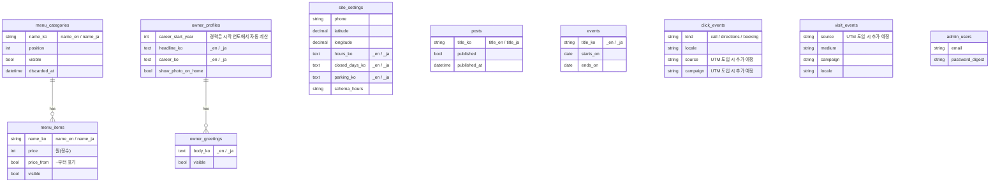

# 은파미용실 홈페이지 기획 기록

> 신규 고객을 확보하고, 기존 고객의 편의(예약, 블로그)를 높이기 위해 만든 홈페이지입니다.
> 개요와 실행 방법은 [README](../README.md)를 참고하세요.

# 1. 서비스 개요

어머니가 운영하는 동네 미용실의 홈페이지입니다. 가격·원장님 경력·길 안내를 공개하고, 비개발자인 원장님이 가격과 블로그를 직접 고칠 수 있습니다.

**대상:** 새로 미용실을 찾는데 가게의 가격과 분위기를 알 수 없어 망설이는 분, 그리고 가게 정보를 직접 고쳐야 하는 원장님.

**해결책:**
1. 가격표와 원장님 경력을 방문 전에 볼 수 있게 공개해 불안을 줄인다.
2. 관리자 화면을 한국어·큰 버튼·한 화면 인라인 편집으로 만들어, 코딩을 모르는 원장님이 직접 수정할 수 있게 한다.

# 2. 이 아이디어는 어디에서 나왔는가

## 2-1. 계기가 된 체험·감정
어머니의 미용실은 단골 손님과 지인의 소개로 손님이 옵니다. 그런데 인터넷에 가게 이름을 검색하면 주소만 나오고, 가격이나 시술 내용 같은 자세한 정보가 없었습니다. 또한 전화로 오는 문의도 대부분 예약과 가격에 관한 것입니다.

**해결책:**
전화 문의에 일일이 응대하는 부담을 줄이기 위해, 홈페이지에 가격 정보와 위치, 예약 기능을 추가한다.

## 2-2. 왜 그것이 "신경 쓰였는가"

**이유:**
고객이 많이 찾는 시간대에 응대가 겹치면 고객 응대의 만족도가 떨어지고, 기존 고객에게도 불편이 생깁니다. 이 문제를 해결하기 위해 위의 기능들을 추가했습니다.

# 3. 과제 정리

## 3-1. 겉으로 보이는 어려움
- 인터넷에 가게 정보가 부족하다 (주소만 나오고 가격·상세 정보가 없다).

## 3-2. 정말 해결하고 싶은 과제 (왜? ×3, 가정 초안)
- 신규 고객 확보
- 홈페이지에 가격·경력·위치를 공개해 신뢰도 높이기
- 경쟁 업체와 구별되는 강점을 살려 경쟁 우위 확보하기
- SNS를 활용해 지역에 알리기
- 네이버 스마트플레이스(리뷰, 예약, 시술 후기, 광고)를 활용해 고객의 편의에 맞게 제공하기

# 4. 대상 사용자

## 4-1. 페르소나 (가정 초안, 어머니께 확인 필요)
- **기존 단골(주 고객층):** 40~70대 여성. 블로그로 유용한 정보를 제공한다.
- **신규 손님:** 이사했거나 다니던 미용실을 바꾸려는 사람, 지인에게 가게 이야기를 들었지만 가격을 모르는 사람. 연령대 【TODO: 50대 전후라는 가정을 실제 손님 사례로 확인】
- **환경:** 스마트폰에서 네이버로 검색하고 지도 앱으로 가까운 미용실을 확인한다.

예를 들어 이사 온 손님이 집 근처 미용실을 찾으려 했지만 찾지 못하고, 결국 지인의 소개로 오게 되는 경우가 있습니다. 이렇게 정보가 부족해서 생기는 빈틈을 메우는 것이 목적입니다.

## 4-2. 본인과 사용자의 거리
**거리감:** 가까운 사람(가족).
- 장점: 요구사항을 직접 듣고, 쓰는 모습을 관찰하고, 오픈 후 효과를 직접 확인할 수 있다.
- 약점: 가족의 의견에 치우쳐 객관성을 잃을 수 있다.
- 대응: 어머니의 의견만이 아니라 신규 손님이 실제로 무엇을 검색하고 묻는지를 함께 확인한다.

## 4-3. 수요·존재 확인
- **처음 쓸 사람:** 원장님(관리자), 지인 소개로 가게 이름을 들은 신규 손님
- **신규 손님이 자주 묻는 것:** 예약과 가격
- **기존 대체 수단:** 전화 문의, 네이버 플레이스(주소 중심)
- **이 사이트로 바뀌는 이유:** 가격과 상세 정보를 방문 전에 볼 수 있다.
- **현재 상태:** 아직 배포 전이므로 실제 이용 데이터는 없다.

## 4-4. 도입·지속의 흐름
1. **계기:** 지인에게 가게 이야기를 듣고 이름을 검색하거나, 지도·네이버에서 미용실을 찾는다.
2. **첫 행동:** 가격표와 원장님 소개를 확인하고 전화로 연결한다.
3. **계속 쓰는 이유:** 블로그의 미용 정보, 가격·영업 안내의 변경.
4. 개인 고객 대상(toC)이며 회원가입을 요구하지 않고, 개인정보 수집은 최소화한다.

# 5. 기존 서비스·경쟁 조사

## 5-1. 비슷한 서비스
**네이버 플레이스** (소상공인 지도·예약 서비스): 가게 정보, 예약, 리뷰 제공. URL: 【TODO】
【TODO】 다른 비교 대상(웹 빌더 등)이 있으면 1개 이상 추가.

## 5-2. 그래도 직접 만들고 싶은 이유
【TODO】 본인의 말로 작성. 후보: 네이버 플레이스만으로는 가게의 이야기(43년 경력)와 가격 안내, 원장님 직접 수정에 한계가 있다고 느낀 점. 단, **네이버 플레이스는 대체가 아니라 함께 쓰는 채널**이라는 점을 분명히 하세요 (6장 참고).

## 5-3. 경쟁 전략

대형·신규 미용실과 같은 방식으로 겨루지 않고 오래 쌓은 신뢰에 집중합니다.

| 경쟁 요소 | 대형·신규 미용실 | 은파미용실의 전략 |
|---|---|---|
| 인테리어 | 강함 | 겨루지 않음 (청결과 사진으로 보완) |
| 트렌드 스타일 | 강함 | 겨루지 않음 |
| 경력·신뢰 | 약함 | **43년 경험**으로 집중 공략 |
| 원장님 직접 시술 | 담당자 변동 | "처음부터 끝까지 한 분" |
| 어르신·중장년 고객 | 소홀한 경우 많음 | **우리 주 고객층**으로 설정 |
| 가격 | 다양 | 가격표를 공개하고, **경상북도 지역별·상주시 평균 요금에 근거해 결정** (이 문서 아래 부록) |

※ 이 표의 "대형·신규 미용실" 열은 가정입니다. 조사 후 사실에 맞게 고치세요.

## 5-4. 차별화를 한 문장으로
"처음 찾는 사람이 방문 전에 가격과 원장님 경력을 확인할 수 있다."

# 6. 사업 관점 (가설 → 시책 → 계측 → 개선)

기술이 아니라 **"만든 뒤 무엇이 바뀌었는가"**를 증명하기 위한 장입니다. 결과는 실측값만 기록합니다.

## 6-1. 가설
가격과 원장님 경력을 방문 전에 공개하면, 처음 찾는 손님의 불안이 줄어 전화·길 찾기·방문이 늘어난다.

## 6-2. 현재 가격표 (관리자 화면에서 수정 가능)

| 분류 | 시술 | 가격 | 근거 |
|---|---|---|---|
| 커트 | 여성 커트 / 남성 커트 | 13,000원~ | 상주시 공식 평균(남 13,000원 · 여 11,666원, 2025-01 기준)과 비슷한 수준. 경북 평균(남 13,655원 · 여 14,078원)보다 약 5~8% 낮음 (이 문서 아래 부록) |
| 파마 | 일반 파마 | 50,000원~ | 상주시 자료 없음. 일반 평균(62,500원) 대비 약 20% 낮음 (전국 평균 기준 참고값) |
| 파마 | 특수 파마 | 100,000~200,000원 (긴 머리 추가 요금) | 상주시 자료 없음. 일반 평균(105,000원) 대비 약 5% 낮음 (참고값). 상한은 일반 범위(150,000원)보다 높음 |
| 화장 | 혼주화장 | 150,000원 | 비교 자료 없음 |

영업시간 오전 9시~오후 7시 · 일요일 휴무 · 주차: 중앙시장 공영주차장 1시간 30분까지 무료, 초과 요금은 미용실 부담

## 6-3. 경쟁·가격 분석
경상북도 시·군별 및 상주시 평균 요금 조사: 이 문서 아래 부록. 조사일과 출처를 남기고 6개월마다 갱신합니다. 표본이 작으므로 통계적 결론이 아니라 **판단의 참고 자료**로 다룹니다.

## 6-4. 시책

| 시책 | 내용 | 운영 주체 | 비고 |
|---|---|---|---|
| 네이버 플레이스 | 정보 정비, 소식·사진 갱신 | 본인 (무료) | 예약·리뷰는 네이버 기능 활용 |
| 네이버 쿠폰 | 신규 커트 할인, 파마 할인, 증정품 | 네이버 플레이스 | **자체 쿠폰 기능은 만들지 않음** (개인정보·운영 부담, 5장 판단과 일관) |
| 인스타그램 | 프로필·게시물 링크에 UTM 부여 | 본인·원장님 | 【운영 방침 확정 TODO】 |

쿠폰의 할인율·조건은 【TODO: 원장님과 합의 후 기입. 수익성 확인 — 할인 후에도 이익이 남는 범위인가】. 네이버 쿠폰·예약의 요금과 수수료 조건은 파트너센터에서 직접 확인하세요.

## 6-5. 계측 (개인 식별 정보 저장 없음)

| 지표 | 방법 | 상태 |
|---|---|---|
| 전화·길 찾기·예약 클릭 수 | `click_events` | 구현 완료 |
| 유입 경로별 방문 수 | UTM 파라미터 + 세션 단위 집계 | 【구현 예정】 |
| 유입별 전환율 | 유입 수 대비 클릭 수 | 【구현 예정】 |
| 신규 내점 경로 | 「어떻게 알고 오셨어요?」 수기 기록 | 【오픈 후】 |

IP·User-Agent·쿠키 기반 식별자는 저장하지 않으며, 세션 안에서만 유입 값을 유지합니다.

## 6-6. 결과와 개선 (실측값만)

| 기간 | 시책 | 유입 | 전화 | 길 찾기 | 신규 내점(수기) | 배운 점 | 다음 개선 |
|---|---|---|---|---|---|---|---|
| 【】 | 【】 | 【】 | 【】 | 【】 | 【】 | 【】 | 【】 |

- 2주 단위로 기록하고, 기간이 짧으면 「참고값」이라고 명시한다.
- 개선(가격표 위치, 버튼 문구 등)을 했다면 날짜와 전후 비교를 남긴다.

# 7. 이 서비스로 제공하고 싶은 가치

## 7-1. 사용자의 변화
- **행동:** 검색 → 가격 확인 → 연락·예약 → 방문
- **기분:** 처음 가는 가게에 대한 불안이 줄어든다.
- **생각:** "여기는 경력이 오래된 원장님이 처음부터 끝까지 해 주는 곳"이라고 믿을 수 있다.

## 7-2. 가치를 한 문장으로
"새로 미용실을 찾는 사람이 방문 전에 가격과 원장의 경력을 확인하고 안심하고 예약할 수 있게 되는 서비스"

# 8. 범위

## MVP로 만든 기능
- 홈 · 미용실 소개 · 블로그 · 찾아오시는 길
- 가격표 공개와 관리자의 직접 수정 (한 화면 인라인 편집)
- 한국어 · 영어 · 일본어 표시 (영어·일본어는 초안)
- 네이버 지도 길 안내, 전화·네이버 예약 버튼, 클릭 수 집계
- 구조화 데이터(JSON-LD), 이미지 자동 축소·WebP 변환

## 정식 릴리스 이후
- 배포(Lightsail), 독립 도메인 교체, 이미지 백업 자동화
- UTM 유입 측정, 네이버 플레이스·쿠폰 운영, 이벤트 배너 관리
- 블로그를 통한 검색 유입 개선, 영어·일본어 전문 검수

# 9. 우려사항과 대책

## ① 블로그 갱신이 멈출 가능성
- **원인:** 가게 운영과 병행하는 원장님이 글 쓸 시간이 없을 수 있다. (가정)
- **대책:** 짧은 글 중심으로 하고 초안은 본인이 도와준다. 【TODO】 실제 운영 방침 확정.

## ② 배포 전이라 효과를 아직 검증하지 못한 점
- **문제:** 신규 고객 확보라는 목적의 달성 여부를 아직 측정할 수 없다.
- **대책:** 6장의 계측 계획에 따라 오픈 후 측정한다. 작은 표본의 결과는 참고값으로 다룬다.

## ③ 무료 서브도메인(DuckDNS) 사용
- **문제:** 신뢰감, 검색 노출, 서비스 지속성에서 독립 도메인보다 불리할 수 있다.
- **대책:** 독립 도메인으로 교체할 수 있는 구조로 두고, 교체 계획을 문서화한다.

## ④ 할인·쿠폰이 수익을 해칠 가능성
- **문제:** 할인으로 매출은 늘어도 이익이 줄 수 있고, 단골이 할인 대상에서 소외되면 불만이 생길 수 있다.
- **대책:** 신규 한정·기간 한정으로 시험 운영하고, 원장님과 수익성을 확인한 뒤 확대한다. 【TODO】

## ⑤ 개인정보와 가게 정보 공개
- **대책:** 클릭·유입 집계는 개인 식별 정보 없이 집계만 한다. 주소·전화·가격 공개는 원장님의 동의를 확인했다. 【TODO: 동의 확인 후 체크】

# 10. 기술 스택

## 10-1. 사용 기술과 선택 이유
Ruby on Rails 8.1 (Hotwire), SQLite(Litestream 백업), Docker, Caddy / AWS Lightsail / GitHub Actions(운영 예정). 후보 비교표는 [README](../README.md)의 「기술 선택과 이유」, 상세는 [docs/decisions.md](decisions.md)에 있습니다.

**도전·불안한 점:** 【TODO】 본인의 말로 작성.

## 10-2. 따라잡기 부족의 우려와 대책
【TODO】 본인의 말로 작성. 후보: 1GB 메모리 환경에서의 운영, AI(Claude 등)를 사용한 부분을 테스트·보안 도구·직접 리뷰로 검증한 방법 ([development.md](development.md) 참고). SQLite WAL, Turbo Stream, Litestream의 동작은 **직접 설명할 수 있도록** 정리해 두세요.

# 부록. 테이블 구성 (ER 도면)

블로그 본문은 Action Text(`content_ko` / `content_en` / `content_ja`), 이미지는 Active Storage 테이블에 저장됩니다.

---

# 부록. 경북 상주시 미용 요금 조사 (경쟁·가격 분석)

> **커트 요금은 경상북도 공식 물가자료의 상주시 값을 넣었습니다. 파마·특수 펌은 상주시 자료가 없어 일반 평균(참고값)만 있습니다.** 더 정확한 자료가 나오면 3장을 바꾸고 4장의 비교를 갱신하세요.

## 1. 상주시 커트 요금 (공식 자료)

- **출처:** [경상북도물가관리시스템 · 개인서비스요금](https://www.gb.go.kr/open_content/mulga/mulga_gb/pages/price_infor/indi_service_charge.jsp) (경상북도 민생경제과 054-880-2634)
- **기준월:** 2025년 1월 (확인한 날: 2026-11-05) — **약 21개월 전 자료라 현재 시세보다 낮을 수 있습니다.**
- **항목 정의(페이지 각주):** 이용료 = 남자 성인 커트 1회 요금, 미용료 = 여자 성인 커트 1회 요금
- **조사 방식:** 시·군별 소수 업소의 평균(상주시 값은 3개 업소 평균으로 보이는 소수 표본)

| 구분 | 남자 성인 커트 | 여자 성인 커트 |
|---|---|---|
| **상주시** | **13,000원** | **11,666원** |
| 경상북도 평균 | 13,655원 | 14,078원 |
| 문경시 | 14,250원 | 14,250원 |
| 예천군 | 13,000원 | 12,666원 |
| 영주시 | 11,000원 | 15,000원 |
| 김천시 | 13,875원 | 15,250원 |
| 안동시 | 11,333원 | 10,166원 |

- 상주시는 **여자 커트(11,666원)가 남자 커트(13,000원)보다 낮게** 집계되어 있습니다. 표본이 작아 생긴 편차일 수 있으므로 해석에 주의하세요.
- 구미시·군위군·의성군·고령군은 이 자료에서 0원(미조사)으로 표시되어 있어 비교에서 제외했습니다.

## 2. 은파미용실 현재 가격 (관리자 화면에서 수정 가능, 2026-11 기준)

| 구분 | 현재 가격 | 비고 |
|---|---|---|
| 여성 커트 · 남성 커트 | 13,000원~ | "~부터" 표기 |
| 일반 파마 | 50,000원~ | |
| 특수 파마 | 100,000원~ (10만~20만원, 긴 머리는 추가 요금) | |
| 혼주화장 | 150,000원 | 비교할 자료 없음 |

## 3. 일반 평균 가격 (파마·특수 펌 참고값, 상주시 자료 아님)

경북·상주시 공식 자료에는 파마 요금이 없어, 전달받은 **일반 평균** 자료를 참고값으로 둡니다.

| 구분 | 평균가 | 일반적 요금 범위 | 비고 |
|---|---|---|---|
| 남성/여성 기본 커트 | 17,000원 | 14,000원 ~ 20,000원 | 샴푸 포함 여부 및 성별에 따라 1~2천 원 차이 |
| 기본 파마 (디자인 펌) | 62,500원 | 50,000원 ~ 80,000원 | 단발/Short 기준 (커트 비용 포함 여부 매장별 상이) |
| 특수 펌 (열펌/아이롱/매직) | 105,000원 | 80,000원 ~ 150,000원 | 기장(머리 길이) 및 영양 추가 시 금액 변동 |

- **출처:** 【TODO: 출처(사이트·자료명)와 URL】 / **조사일:** 【TODO】 / **대상 지역:** 【TODO: 전국 등】
- 출처가 확인되기 전까지는 **확인되지 않은 참고값**입니다. 같은 자료의 커트 평균(17,000원)은 상주시 공식 값(남 13,000 · 여 11,666원)보다 훨씬 높아, **지방 시세와 차이가 크다**는 점을 보여 줍니다.

## 4. 비교 (참고값)

#### 커트 — 상주시 공식 평균과의 비교
| 은파 (13,000원~) 대비 | 기준 값 | 차이 |
|---|---|---|
| 상주시 남자 커트 | 13,000원 | **같음** (0%) |
| 상주시 여자 커트 | 11,666원 | 약 **11% 높음** |
| 경상북도 남자 커트 평균 | 13,655원 | 약 5% 낮음 |
| 경상북도 여자 커트 평균 | 14,078원 | 약 8% 낮음 |

#### 파마·특수 펌 — 일반 평균과의 비교 (상주시 값 아님)
| 구분 | 은파 | 일반 평균 | 평균 대비 | 일반 범위와의 관계 |
|---|---|---|---|---|
| 일반 파마 | 50,000원~ | 62,500원 | 약 20% 낮음 | 범위(50,000~80,000원)의 하한과 같음 |
| 특수 펌 | 100,000원~ | 105,000원 | 약 5% 낮음 | 범위(80,000~150,000원) 안. 상한 200,000원은 범위 상한보다 높음 |

계산: (은파 가격 − 비교 값) ÷ 비교 값. 소수점 이하는 반올림.

#### 해석할 때 주의
- 은파의 가격은 **"~부터"(최소 가격)** 이고, 공식 자료는 **1회 요금의 평균**입니다. 같은 조건으로 맞춰 비교하세요.
- **기준월이 2025년 1월**이라 지금은 더 올랐을 수 있습니다. 최신 월 자료를 경상북도물가관리시스템에서 다시 확인하세요.
- 상주시 값은 **3개 업소 정도의 소수 표본**이라 통계적 결론이 아니라 **판단의 참고 자료**입니다.
- 커트 가격은 상주시 평균과 같은 수준이라 "싸다"고 말할 근거는 약합니다. 가격 홍보보다 **43년 경력·직접 시술의 신뢰**를 앞세우는 전략([planning.md](planning.md) 5-3)과 맞습니다.
- 파마 비교는 **전국 일반 평균 기준**이라 지방 시세가 더 낮을 수 있고, 그 경우 "평균보다 낮다"는 인상은 과장됩니다. 상주시 파마 자료가 나오면 다시 비교하세요.

## 5. 갱신 규칙
- 조사일과 출처를 반드시 남깁니다.
- 6개월마다 갱신하고, 가격표를 바꿀 때는 이 문서의 비교도 함께 고칩니다.
