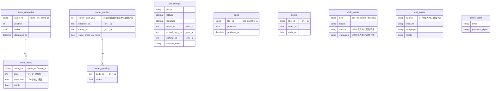

# 恩波美容室ホームページ 企画記録

> 新規のお客様を増やし、既存のお客様の利便性（予約・ブログ）を高めるために作ったホームページです。
> 概要と起動方法は [README](../README.md) を参照してください。

# 1. サービス概要

母が営む街の美容室のホームページです。料金・院長の経歴・道案内を公開し、ITに不慣れな院長が、料金やブログを自分で更新できます。

**対象:** 新しく美容室を探していて、お店の料金や雰囲気が分からず迷っている方。そして、お店の情報を自分で更新する必要のある院長。

**解決策:**
1. 料金表と院長の経歴を来店前に見られるよう公開し、不安を減らす。
2. 管理画面を「韓国語・大きなボタン・1画面でのインライン編集」にして、コードが分からない院長が自分で更新できるようにする。

# 2. このアイデアはどこから出てきたか

## 2-1. きっかけとなった体験・感情
母の美容室は、常連のお客様と、知人の紹介でお客様が来ます。ところが、インターネットでお店の名前を検索すると住所しか出てこず、料金や施術内容といった詳しい情報がありませんでした。また、電話でくる問い合わせも、ほとんどが予約と料金についてです。

**解決策:**
電話の問い合わせに一件ずつ対応する負担を減らすため、ホームページに料金情報・場所・予約の機能を追加する。

## 2-2. なぜそれが「気になった」のか

**理由:**
お客様が多く訪れる時間帯に対応が重なると、接客の満足度が下がり、既存のお客様にも不便が生じます。この問題を解決するため、上の機能を追加しました。

# 3. 課題の整理

## 3-1. 表面上の困りごと
- インターネット上にお店の情報が少ない（住所しか出てこず、料金や詳細が分からない）。

## 3-2. 本当に解決したい課題（なぜ？×3、仮の初稿）
- 新規のお客様の獲得
- ホームページに料金・経歴・場所を公開して、信頼感を高める
- 他店と差がつく強みを生かして、競争上の優位を確保する
- SNS を活用して地域に知ってもらう
- NAVER スマートプレイス（口コミ、予約、施術後の写真、広告）を活用して、お客様の利便に合わせて提供する

# 4. 対象ユーザー

## 4-1. ペルソナ（仮の初稿。母への確認が必要）
- **既存の常連（主な客層）:** 40〜70代の女性。ブログで役立つ情報を提供する。
- **新規のお客様:** 引っ越してきた人や、通っていた美容室を変えたい人、知人からお店の話を聞いたが料金が分からない人。年齢層は【TODO: 50代前後という仮定を、実際のお客様の例で確認】
- **環境:** スマートフォンで NAVER で検索し、地図アプリで近くの美容室を確認する。

たとえば、引っ越してきたお客様が家の近くの美容室を探しても見つからず、結局、知人の紹介で来店することがあります。このように情報が足りないことで生じるすき間を埋めるのが目的です。

## 4-2. 自分とユーザーとの距離
**距離感:** 身近な人（家族）。
- 長所: 要望を直接聞き、使っている様子を観察し、公開後の効果を自分で確認できる。
- 弱点: 家族の意見に偏り、客観性を失うおそれがある。
- 対応: 母の意見だけでなく、新規のお客様が実際に何を検索し、何を尋ねるかも合わせて確認する。

## 4-3. 需要・存在の確認
- **最初に使う人:** 院長（管理者）、知人の紹介でお店の名前を聞いた新規のお客様
- **新規のお客様がよく尋ねること:** 予約と料金
- **既存の代替手段:** 電話での問い合わせ、NAVER プレイス（住所が中心）
- **このサイトに切り替える理由:** 料金と詳しい情報を、来店前に見られる。
- **現状:** まだデプロイ前なので、実際の利用データはない。

## 4-4. 導入・継続の流れ
1. **きっかけ:** 知人からお店の話を聞いて名前を検索する、または地図・NAVER で美容室を探す。
2. **最初の行動:** 料金表と院長の紹介を確認して、電話をかける。
3. **使い続ける理由:** ブログの美容情報、料金・営業案内の更新。
4. 個人のお客様向け（toC）で、会員登録は求めず、個人情報の収集は最小限にする。

# 5. 既存サービス・競合の調査

## 5-1. 似たサービス
**NAVER プレイス**（小規模事業者向けの地図・予約サービス）: お店の情報、予約、口コミを提供。URL: 【TODO】
【TODO】 ほかに比較する対象（Web ビルダーなど）があれば、1つ以上追加する。

## 5-2. それでも自分で作りたい理由
【TODO】 自分の言葉で書く。候補: NAVER プレイスだけでは、お店のストーリー（経験43年）や料金の案内、院長による直接の更新に限界があると感じた点。ただし、**NAVER プレイスは代替ではなく、併用するチャネル**であることを明確にする（6章を参照）。

## 5-3. 競合戦略

大手・新規の美容室と同じ土俵では競わず、長年積み上げた信頼に集中します。

| 競争の要素 | 大手・新規の美容室 | 恩波美容室の戦略 |
|---|---|---|
| インテリア | 強い | 競わない（清潔さと写真で補う） |
| トレンドのスタイル | 強い | 競わない |
| 経歴・信頼 | 弱い | **43年の経験**に集中して訴求 |
| 院長が自ら施術 | 担当者が変わる | 「最初から最後まで同じ人」 |
| ご年配・中高年のお客様 | おろそかな場合が多い | **私たちの主な客層**として位置づける |
| 価格 | さまざま | 料金表を公開し、**慶尚北道の地域別・尚州市の平均料金を根拠に決定**（この文書の付録） |

※ この表の「大手・新規の美容室」の列は仮定です。調査のうえ、事実に合わせて直してください。

## 5-4. 差別化を一文で
「初めて探す人が、来店前に料金と院長の経歴を確認できる。」

# 6. ビジネス視点（仮説 → 施策 → 計測 → 改善）

技術ではなく、**「作ったあとに何が変わったか」**を示すための章です。結果は実測値だけを記録します。

## 6-1. 仮説
料金と院長の経歴を来店前に公開すれば、初めて探すお客様の不安が減り、電話・道案内・来店が増える。

## 6-2. 現在の料金表（管理画面で変更可能）

| 分類 | 施術 | 料金 | 根拠 |
|---|---|---|---|
| カット | 女性カット / 男性カット | 13,000ウォン〜 | 尚州市の公式平均（男性 13,000ウォン・女性 11,666ウォン、2025-01 時点）と同程度。慶北の平均（男性 13,655ウォン・女性 14,078ウォン）より約 5〜8% 低い（この文書の付録） |
| パーマ | 一般パーマ | 50,000ウォン〜 | 尚州市のデータなし。一般的な平均（62,500ウォン）より約 20% 低い（全国平均を基準にした参考値） |
| パーマ | 特殊パーマ | 100,000〜200,000ウォン（長い髪は追加料金） | 尚州市のデータなし。一般的な平均（105,000ウォン）より約 5% 低い（参考値）。上限は一般的な範囲（150,000ウォン）より高い |
| メイク | 婚礼の親族向けメイク（혼주화장） | 150,000ウォン | 比較できるデータなし |

営業時間 午前9時〜午後7時 · 日曜定休 · 駐車場: 中央市場の公営駐車場が1時間30分まで無料、超過分は美容室が負担

## 6-3. 競合・価格の分析
慶尚北道の市・郡別および尚州市の平均料金の調査: この文書の付録を参照。調査日と出典を記録し、6か月ごとに更新します。標本が小さいため、統計的な結論ではなく**判断の参考資料**として扱います。

## 6-4. 施策

| 施策 | 内容 | 運営の主体 | 備考 |
|---|---|---|---|
| NAVER プレイス | 情報の整備、お知らせ・写真の更新 | 本人（無料） | 予約・口コミは NAVER の機能を活用 |
| NAVER クーポン | 新規のカット割引、パーマ割引、プレゼント | NAVER プレイス | **独自のクーポン機能は作らない**（個人情報・運用の負担。5章の判断と一貫） |
| Instagram | プロフィール・投稿のリンクに UTM を付ける | 本人・院長 | 【運用方針の確定 TODO】 |

クーポンの割引率・条件は【TODO: 院長と合意してから記入。収益性の確認 — 割引後も利益が残る範囲か】。NAVER クーポン・予約の料金と手数料の条件は、パートナーセンターで直接確認してください。

## 6-5. 計測（個人を特定する情報は保存しない）

| 指標 | 方法 | 状態 |
|---|---|---|
| 電話・道案内・予約のクリック数 | `click_events` | 実装済み |
| 流入経路別の訪問数 | UTM パラメータ + セッション単位の集計 | 【実装予定】 |
| 流入別のコンバージョン率 | 流入数に対するクリック数 | 【実装予定】 |
| 新規来店の経路 | 「どうやって知りましたか？」の手書き記録 | 【オープン後】 |

IP・User-Agent・Cookie をもとにした識別子は保存せず、セッションの中でのみ流入の値を保持します。

## 6-6. 結果と改善（実測値のみ）

| 期間 | 施策 | 流入 | 電話 | 道案内 | 新規来店（手書き） | 学んだこと | 次の改善 |
|---|---|---|---|---|---|---|---|
| 【】 | 【】 | 【】 | 【】 | 【】 | 【】 | 【】 | 【】 |

- 2週間単位で記録し、期間が短い場合は「参考値」と明記する。
- 改善（料金表の位置、ボタンの文言など）をしたら、日付と前後の比較を残す。

# 7. このサービスで提供したい価値

## 7-1. ユーザーの変化
- **行動:** 検索 → 料金を確認 → 連絡・予約 → 来店
- **気持ち:** 初めて行くお店への不安が減る。
- **考え:** 「ここは、経験の長い院長が最初から最後まで担当してくれるお店だ」と信じられる。

## 7-2. 価値を一文で
「新しく美容室を探す人が、来店前に料金と院長の経歴を確認して、安心して予約できるようになるサービス」

# 8. スコープ

## MVP で作った機能
- ホーム・美容室紹介・ブログ・アクセス
- 料金表の公開と、管理者による直接の更新（1画面のインライン編集）
- 韓国語・英語・日本語での表示（英語・日本語は草稿）
- NAVER 地図の道案内、電話・NAVER 予約のボタン、クリック数の集計
- 構造化データ（JSON-LD）、画像の自動縮小・WebP 変換

## 正式リリース以降
- デプロイ（Lightsail）、独自ドメインへの切り替え、画像バックアップの自動化
- UTM による流入の計測、NAVER プレイス・クーポンの運用、お知らせバナーの管理
- ブログによる検索流入の改善、英語・日本語の専門的な校閲

# 9. 懸念事項と対策

## ① ブログの更新が止まる可能性
- **原因:** 店の運営と並行する院長に、記事を書く時間がないかもしれない（仮定）。
- **対策:** 短い記事を中心にし、下書きは本人が手伝う。【TODO】 実際の運用方針を確定する。

## ② デプロイ前のため、効果をまだ検証できていない点
- **問題:** 新規のお客様の獲得という目的を達成できたか、まだ測定できない。
- **対策:** 6章の計測計画に沿って、オープン後に測定する。小さな標本の結果は参考値として扱う。

## ③ 無料サブドメイン（DuckDNS）の使用
- **問題:** 信頼感・検索での見え方・サービスの継続性で、独自ドメインより不利になりうる。
- **対策:** 独自ドメインへ切り替えられる構成にしておき、切り替えの計画を文書にする。

## ④ 割引・クーポンが収益を損なう可能性
- **問題:** 割引で売上が増えても利益が減ることがある。また、常連が割引の対象外になると不満が出るおそれがある。
- **対策:** 新規限定・期間限定で試験運用し、院長と収益性を確認してから広げる。【TODO】

## ⑤ 個人情報とお店の情報の公開
- **対策:** クリック・流入の集計は、個人を特定する情報なしで、件数だけを集計する。住所・電話・料金の公開は、院長の同意を確認済み。【TODO: 同意を確認してチェックする】

# 10. 技術スタック

## 10-1. 使用技術と選定理由
Ruby on Rails 8.1（Hotwire）、SQLite（Litestream でバックアップ）、Docker、Caddy / AWS Lightsail / GitHub Actions（運用予定）。候補の比較表は [README](../README.md) の「5. 使用技術・技術選定理由」、詳細は [docs/decisions.md](decisions.md) にあります。

**挑戦・不安な点:** 【TODO】 自分の言葉で書く。

## 10-2. 知識が追いついていない不安と対策
【TODO】 自分の言葉で書く。候補: メモリ 1GB の環境での運用、AI（Claude など）を使った部分を、テスト・セキュリティツール・自分のレビューで検証した方法（[development.md](development.md) を参照）。SQLite の WAL、Turbo Stream、Litestream の動きは、**自分で説明できるよう**整理しておく。

# 付録. テーブル構成（ER 図）

ブログ本文は Action Text（`content_ko` / `content_en` / `content_ja`）、画像は Active Storage のテーブルに保存されます。

---

# 付録. 慶尚北道 尚州市の美容料金の調査（競合・価格の分析）

> **カットの料金は、慶尚北道の公式な物価データのうち尚州市の値を入れました。パーマ・特殊パーマは尚州市のデータがないため、一般的な平均（参考値）のみです。** より正確なデータが出たら 3 を差し替え、4 の比較を更新してください。

## 1. 尚州市のカット料金（公式データ）

- **出典:** [慶尚北道物価管理システム · 個人サービス料金](https://www.gb.go.kr/open_content/mulga/mulga_gb/pages/price_infor/indi_service_charge.jsp)（慶尚北道 民生経済課 054-880-2634）
- **基準月:** 2025年1月（確認した日: 2026-11-05）— **約21か月前のデータのため、現在の相場より低い可能性があります。**
- **項目の定義（ページの注記）:** 利用料 = 男性の成人カット1回の料金、美容料 = 女性の成人カット1回の料金
- **調査方法:** 市・郡ごとの少数の店舗の平均（尚州市の値は、3店舗の平均とみられる小さな標本）

| 区分 | 男性の成人カット | 女性の成人カット |
|---|---|---|
| **尚州市** | **13,000ウォン** | **11,666ウォン** |
| 慶尚北道の平均 | 13,655ウォン | 14,078ウォン |
| 聞慶市 | 14,250ウォン | 14,250ウォン |
| 醴泉郡 | 13,000ウォン | 12,666ウォン |
| 栄州市 | 11,000ウォン | 15,000ウォン |
| 金泉市 | 13,875ウォン | 15,250ウォン |
| 安東市 | 11,333ウォン | 10,166ウォン |

- 尚州市は、**女性のカット（11,666ウォン）が男性のカット（13,000ウォン）より低く**集計されています。標本が小さいために生じた差かもしれないので、解釈には注意してください。
- 亀尾市・軍威郡・義城郡・高霊郡は、このデータでは 0 ウォン（未調査）と表示されているため、比較から除きました。

## 2. 恩波美容室の現在の料金（管理画面で変更可能、2026-11 時点）

| 区分 | 現在の料金 | 備考 |
|---|---|---|
| 女性カット・男性カット | 13,000ウォン〜 | 「〜から」表記 |
| 一般パーマ | 50,000ウォン〜 | |
| 特殊パーマ | 100,000ウォン〜（10万〜20万ウォン、長い髪は追加料金） | |
| 婚礼の親族向けメイク（혼주화장） | 150,000ウォン | 比較できるデータなし |

## 3. 一般的な平均料金（パーマ・特殊パーマの参考値。尚州市のデータではない）

慶北・尚州市の公式データにはパーマの料金がないため、受け取った**一般的な平均**のデータを参考値として置きます。

| 区分 | 平均価格 | 一般的な料金の範囲 | 備考 |
|---|---|---|---|
| 男女の基本カット | 17,000ウォン | 14,000ウォン〜20,000ウォン | シャンプーの有無や性別によって 1〜2千ウォンの差 |
| 基本のパーマ（デザインパーマ） | 62,500ウォン | 50,000ウォン〜80,000ウォン | ボブ/ショート基準（カット代を含むかは店舗ごとに異なる） |
| 特殊パーマ（熱パーマ/アイロン/縮毛矯正） | 105,000ウォン | 80,000ウォン〜150,000ウォン | 髪の長さや、トリートメントの追加で金額が変わる |

- **出典:** 【TODO: 出典（サイト・資料名）と URL】 / **調査日:** 【TODO】 / **対象地域:** 【TODO: 全国など】
- 出典が確認できるまでは、**未確認の参考値**です。同じ資料のカットの平均（17,000ウォン）は、尚州市の公式の値（男性 13,000・女性 11,666ウォン）よりかなり高く、**地方の相場とは差が大きい**ことを示しています。

## 4. 比較（参考値）

#### カット — 尚州市の公式平均との比較
| 恩波（13,000ウォン〜）との比較 | 基準の値 | 差 |
|---|---|---|
| 尚州市の男性カット | 13,000ウォン | **同じ**（0%） |
| 尚州市の女性カット | 11,666ウォン | 約 **11% 高い** |
| 慶尚北道の男性カットの平均 | 13,655ウォン | 約 5% 低い |
| 慶尚北道の女性カットの平均 | 14,078ウォン | 約 8% 低い |

#### パーマ・特殊パーマ — 一般的な平均との比較（尚州市の値ではない）
| 区分 | 恩波 | 一般的な平均 | 平均との比較 | 一般的な範囲との関係 |
|---|---|---|---|---|
| 一般パーマ | 50,000ウォン〜 | 62,500ウォン | 約 20% 低い | 範囲（50,000〜80,000ウォン）の下限と同じ |
| 特殊パーマ | 100,000ウォン〜 | 105,000ウォン | 約 5% 低い | 範囲（80,000〜150,000ウォン）の中。上限の 200,000ウォンは、範囲の上限より高い |

計算式: （恩波の料金 − 比較の値）÷ 比較の値。小数点以下は四捨五入。

#### 解釈するときの注意
- 恩波の料金は**「〜から」（最低料金）**で、公式データは**1回の料金の平均**です。同じ条件にそろえて比較してください。
- **基準月が2025年1月**のため、現在はもっと上がっているかもしれません。最新月のデータを慶尚北道物価管理システムで、あらためて確認してください。
- 尚州市の値は、**3店舗程度の小さな標本**なので、統計的な結論ではなく**判断の参考資料**です。
- カットの料金は尚州市の平均と同じ水準なので、「安い」と言える根拠は弱いです。価格を前面に出すより、**43年の経歴・院長が自ら施術する信頼**を打ち出す戦略（[planning.md](planning.md) 5-3）と合っています。
- パーマの比較は**全国の一般的な平均が基準**のため、地方の相場はもっと低い可能性があり、その場合「平均より低い」という印象は誇張になります。尚州市のパーマのデータが出たら、あらためて比較してください。

## 5. 更新のルール
- 調査日と出典を必ず残す。
- 6か月ごとに更新し、料金表を変えるときは、この文書の比較も合わせて直す。
